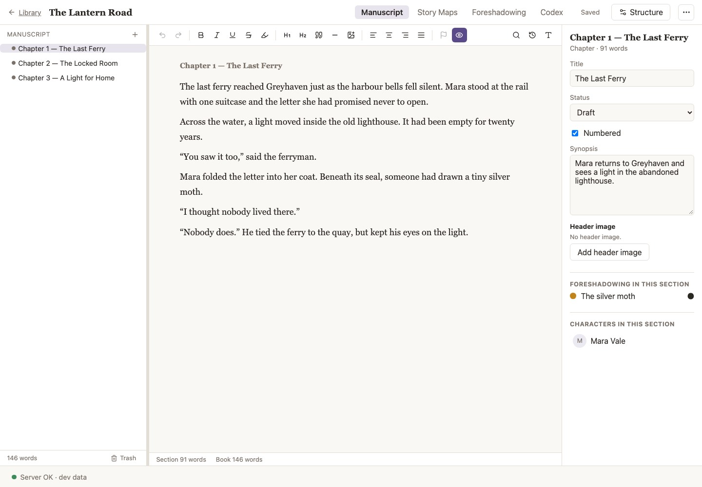
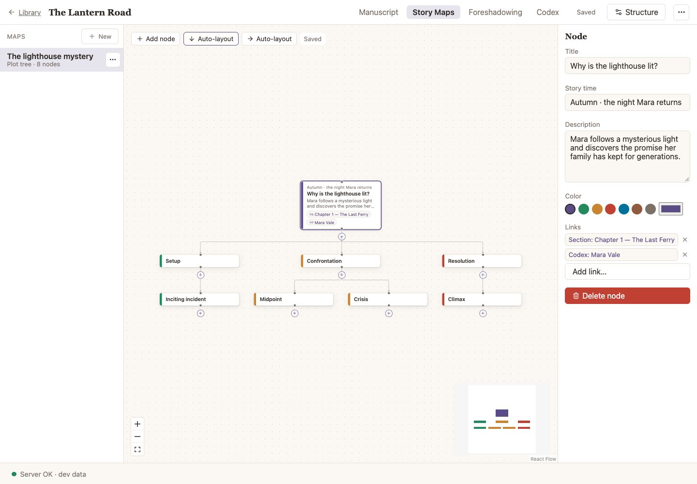
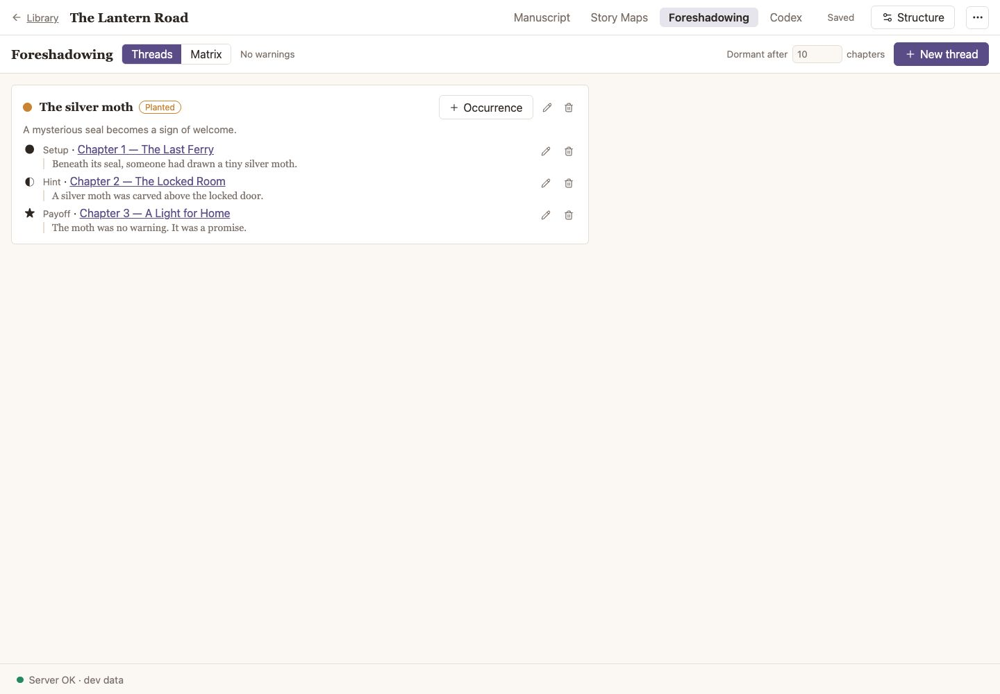
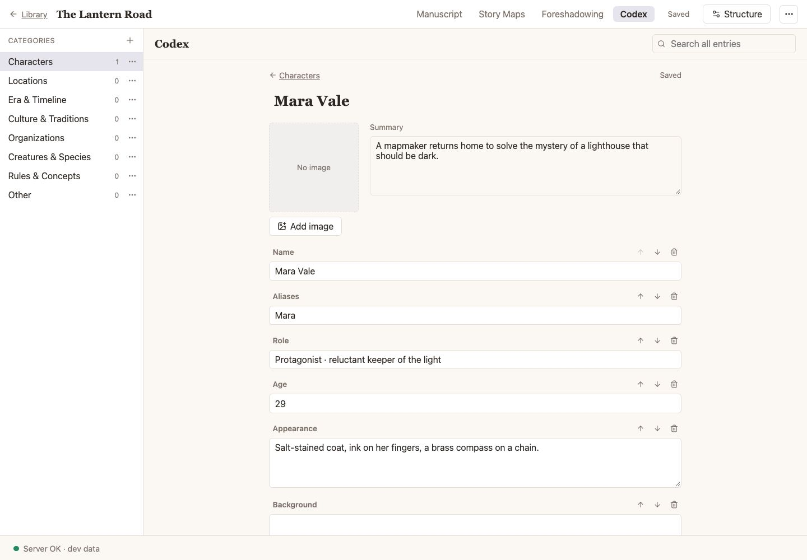
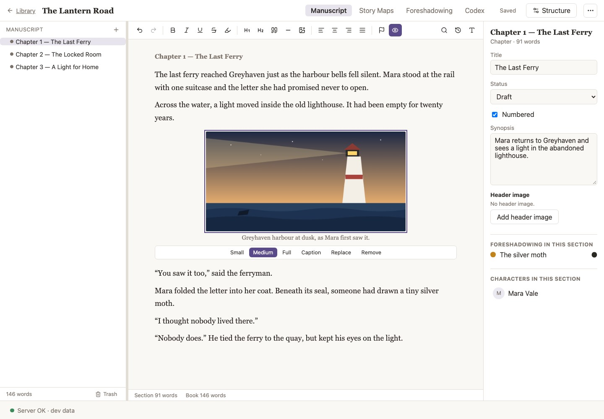

<div align="center">


# NovelStudio

*Somewhere, a story begins.*

**A calm, local-first writing studio for long-form fiction.**<br />
Drag chapters into a new order and every number follows. Plan with story maps, follow every clue to its payoff, and keep your pages safe behind four layers of backup.

[](https://github.com/MINGYISU/NovelStudio/actions/workflows/ci.yml)
[](LICENSE)


[Website](https://mingyisu.github.io/NovelStudio/) · [User guide](docs/USER_GUIDE.md) · [Quick start](#quick-start) · [For developers](#for-developers)

<br />



</div>

## Why NovelStudio

Your books stay on your computer. There are no accounts, no cloud, no subscriptions, no telemetry, and no internet connection is needed to write. NovelStudio is a small Node server plus a browser UI that only listens on `127.0.0.1`.

It exists for one reason: **reordering a long manuscript should be effortless and safe.** Chapter numbers are computed from the order, never typed into titles, and every link between chapters, maps, clues and notes points to a permanent ID, so nothing breaks when you rearrange.

## Features

| | |
|---|---|
| **Library** | A shelf of books with covers (or generated ones), word counts and backup reminders. Trash with typed-title confirmation before anything is purged. |
| **Manuscript tree** | Volumes, parts, chapters and scenes. Drag anything anywhere valid, or use <kbd>Option</kbd>+<kbd>↑</kbd>/<kbd>↓</kbd>; numbers update at once. `Chapter 3` or `第三章`, with unnumbered prologues and interludes. |
| **Editor** | Clean rich text with just the formatting a novel needs, ~1 s autosave, section snapshots, find and replace across the whole book, focus mode, and per-book display settings (fonts, themes, indent, width). |
| **Illustrations** | Images between paragraphs and a header image per section, always on a line of their own so they can never break your layout. |
| **Story maps** | Node-and-edge diagrams for plot, timelines and character arcs, with auto-layout and links to chapters and characters. |
| **Foreshadowing** | Track setups, hints and payoffs per thread, see them in a chapter-by-chapter matrix, get warnings when a reorder breaks the order, and anchor clues to the exact words. |
| **Codex** | Character cards and worldbuilding entries with custom fields and one search across everything. |
| **Import / export** | Import `.txt` or `.md` (UTF-8 or GB18030) with a preview first; export Markdown or plain text. |
| **Two languages** | Switch the whole interface between English and 简体中文 at any time. Your books are never changed by it. |

<table>
  <tr>
    <td width="50%"><br /><sub><b>Story maps</b>: plot as a diagram, linked to your chapters.</sub></td>
    <td width="50%"><br /><sub><b>Foreshadowing</b>: every clue followed to its payoff.</sub></td>
  </tr>
  <tr>
    <td width="50%"><br /><sub><b>Codex</b>: characters and worlds, always at hand.</sub></td>
    <td width="50%"><br /><sub><b>Illustrations</b>: pictures that never break the layout.</sub></td>
  </tr>
</table>

New here? The [illustrated user guide](docs/USER_GUIDE.md) walks through a made-up novel, *The Lantern Road*, from first chapter to backup.

## Quick start

**Requirements:** Node.js 24 or newer (`.nvmrc` pins the version used in development) and a modern browser. NovelStudio is designed for macOS; the launcher and the default data folder are macOS-specific.

```sh
git clone https://github.com/MINGYISU/NovelStudio.git
cd NovelStudio
npm install
npm run build
npm start          # http://127.0.0.1:4317
```

**On a Mac**, you can instead double-click `NovelStudio.command` (or run `./NovelStudio.command`). It builds the app if needed, starts the server in a Terminal window, and opens your browser. Press <kbd>Ctrl</kbd>+<kbd>C</kbd> in that window to stop. If the server is already running, it only opens the browser.

**Install as an app:** in Chrome or Edge, choose *Install NovelStudio* to get its own window and Dock icon. The server still has to be running.

`npm start` uses your **real library**. To change the port, set `PORT` (see [.env.example](.env.example)); the server always binds to `127.0.0.1`.

### Where your data lives

| What | Where |
|---|---|
| Live database, images, hourly backups | `~/Library/Application Support/NovelStudio/` |
| Cold backups (JSON) | The folder you choose in **Settings**, ideally on another drive or a synced folder |

## Keeping your work safe

Data safety beats speed and features here. Four layers stand between you and a lost chapter:

| Layer | What it does | Protects against |
|---|---|---|
| **1. Autosave** | Saves about a second after you stop typing, and at once when you switch sections or leave the page | Closing the tab, crashes |
| **2. Snapshots** | Earlier versions of every section (newest 50 kept), taken while you edit and before any replace or restore | "I deleted a paragraph yesterday" |
| **3. Hot backups** | A full database copy on every start and hourly after changes (newest 20 kept). Restore from **Settings → Automatic database backups**; it applies on the next start and the replaced database is kept | A bad migration, corrupted rows |
| **4. Cold backup** | One human-readable `.novelstudio.json` file per book plus a SHA-256 checksum, written to a folder you choose | A lost database or data folder, or the app itself breaking |

Set the cold backup folder in **Settings**, then export from a book card's menu, the workspace menu, or **Export all books**. Restore from the Library with **New → Import cold backup**. Details are in [docs/COLD_BACKUP_FORMAT.md](docs/COLD_BACKUP_FORMAT.md).

You can check and use a backup without the app:

```sh
shasum -a 256 -c <file>.novelstudio.json.sha256   # verify the checksum
npm run verify:cold -- <file>                     # verify with the app's own checks
npm run backup:cold -- --out <folder>             # export all books from the command line
npm run restore:cold -- <file>                    # restore as a new book, no UI needed
jq -r '.manuscript[] | recurse(.children[]) | "\n\n## " + .displayTitle + "\n\n" + .plainText' <file> > manuscript.txt
```

The CLI scripts use `./.data-dev` unless `NOVEL_DATA_DIR` is set. For your real data, run them with `NODE_ENV=production`, for example `NODE_ENV=production npm run backup:cold`.

## For developers

NovelStudio is one npm package: a React 19 UI (Vite, Tiptap, react-arborist, React Flow) and a Fastify server that owns a SQLite database (better-sqlite3), written in strict TypeScript and validated with Zod. Start with the [developer guide](docs/DEVELOPER_ARCHITECTURE.md); exact rules live in [docs/ARCHITECTURE.md](docs/ARCHITECTURE.md).

```sh
npm install
npm run seed:dev   # optional: fill ./.data-dev with sample books
npm run dev        # UI on http://127.0.0.1:5173, API on :4318, data in ./.data-dev
```

| Command | Purpose |
|---|---|
| `npm run dev` | Server (watch) and Vite dev server, using `./.data-dev` |
| `npm run build` | Type-check, then build the client and server into `dist/` |
| `npm test` | Unit and API tests (Vitest), each in a fresh temp data directory |
| `npm run test:e2e` | End-to-end tests (Playwright); run `npx playwright install chromium` once |
| `npm run typecheck` · `npm run lint` · `npm run format` | Static checks and formatting |

Before you push, `typecheck`, `lint`, `test` and `test:e2e` must pass; CI runs the same checks on every pull request to `main`.

**Ground rules** (the full list is in [AGENTS.md](AGENTS.md), which also applies to AI coding agents):

- **Never touch the real data directory** or any cold backup folder while developing. Dev mode refuses to start if it points at the real data; tests use temp directories and fixtures contain made-up text only.
- Schema changes only through a **new numbered file** in `src/server/db/migrations/`; never edit an existing one. Writes touching several rows run in one transaction.
- Any new persistent data must also be added to the cold backup export, restore and its Zod schema in the same change.
- SQL lives only in `src/server/repos/`; `src/shared/` stays pure (no DOM, no Node APIs, no I/O).
- All interface text goes through `t()` with both `en` and `zh-CN` entries.
- No new dependencies without asking; versions are pinned exactly.

### Project website

[site/](site) is the dependency-free static page behind the [project website](https://mingyisu.github.io/NovelStudio/). It reuses the guide screenshots and app icons, and the [Pages workflow](.github/workflows/pages.yml) deploys it from `main`.

```sh
node scripts/build-site.mjs                      # assembles ./_site
python3 -m http.server 4399 --directory _site    # preview at http://127.0.0.1:4399
```

## Documentation


| Document | For | Purpose |
|---|---|---|
| [Visual identity](docs/BRAND.md) | Everyone | The corner girl icon and supporting illustrations |
| [User guide](docs/USER_GUIDE.md) | Writers | Illustrated walkthroughs: write, organize, plan, back up, recover |
| [PRD](docs/PRD.md) | Everyone | What the product does, with requirement IDs such as `MOVE-05` |
| [Developer guide](docs/DEVELOPER_ARCHITECTURE.md) | Developers | How the pieces fit together; where to start for common changes |
| [Architecture](docs/ARCHITECTURE.md) | Developers | Stack, schema, algorithms and API in detail |
| [Cold backup format](docs/COLD_BACKUP_FORMAT.md) | Everyone | The last-resort JSON backup format |
| [Roadmap](docs/ROADMAP.md) | Developers | Milestones and their done-when checklists |
| [AGENTS.md](AGENTS.md) | AI agents | Rules for coding agents working in this repo |

## Status

NovelStudio is a personal project built one milestone at a time, with unit, API and end-to-end tests at each step. Milestones M0 to M11 (library, drag-and-drop tree, editor, cold backup, codex, story maps, foreshadowing, import and export, English and 简体中文, illustrations) are all accepted. See the [roadmap](docs/ROADMAP.md).

## License

[MIT](LICENSE)
