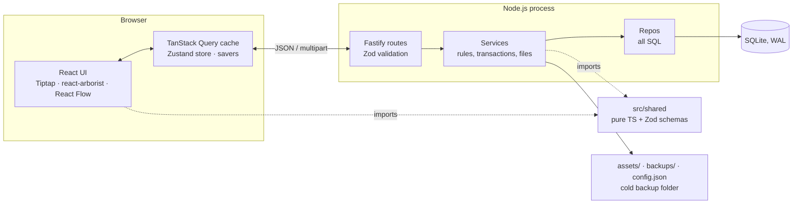
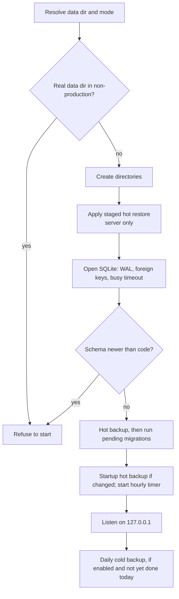
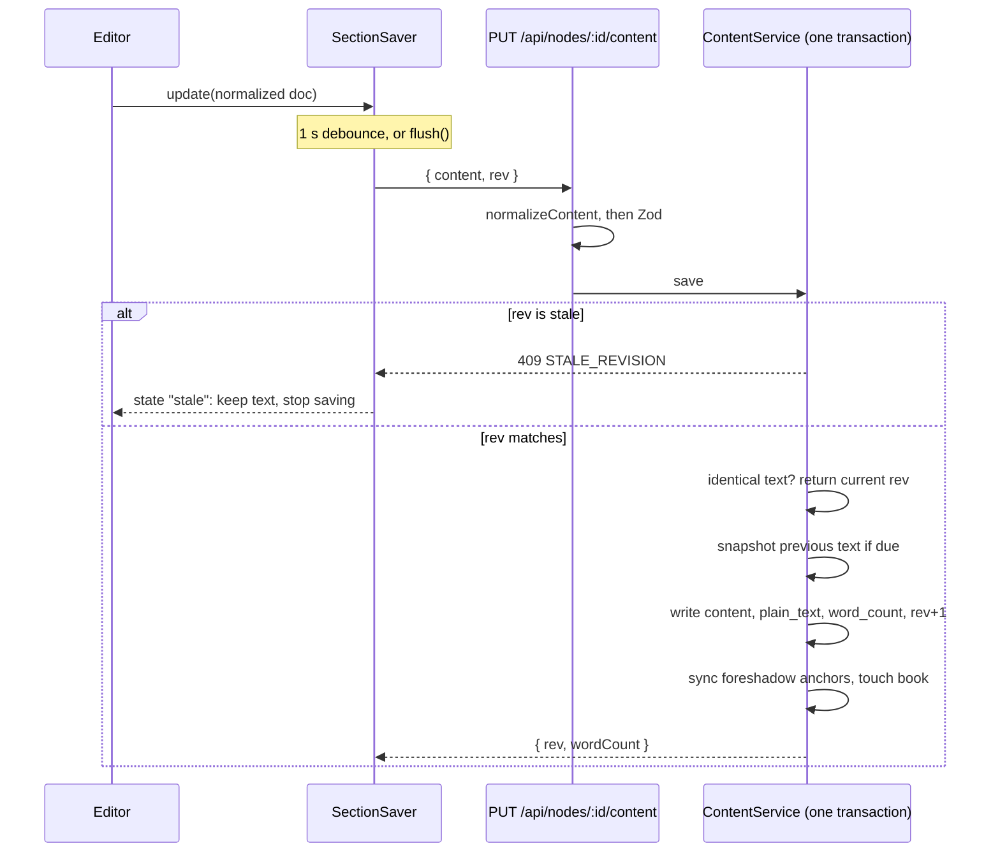
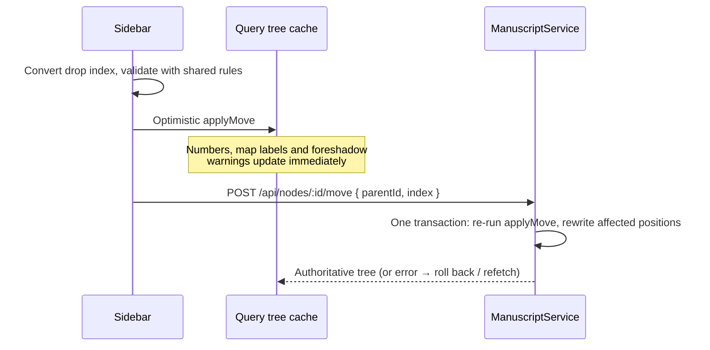

# NovelStudio — Developer Guide to the Architecture

This guide is for a developer who is about to change the code. It explains how the pieces fit together, the few ideas behind most design choices, and where to start for common changes.

It is deliberately short. Exact rules (API shapes, error codes, limits, algorithms) live in [ARCHITECTURE.md](./ARCHITECTURE.md), requirements in [PRD.md](./PRD.md), milestone status in [ROADMAP.md](./ROADMAP.md), and the backup file layout in [COLD_BACKUP_FORMAT.md](./COLD_BACKUP_FORMAT.md). When this guide and the code disagree, the code wins; fix the guide.

Contents:

1. [The 5-minute picture](#1-the-5-minute-picture)
2. [Three ideas that explain most of the code](#2-three-ideas-that-explain-most-of-the-code)
3. [Where state lives](#3-where-state-lives)
4. [Key flows](#4-key-flows)
5. [Recipes for common changes](#5-recipes-for-common-changes)
6. [Known sharp edges](#6-known-sharp-edges)
7. [Running and checking](#7-running-and-checking)

---

## 1. The 5-minute picture

NovelStudio is one npm package: a React app in the browser and one Node.js (Fastify) process that owns the SQLite database and all files. Everything stays on `127.0.0.1`. There are no accounts, no cloud services, and no background workers outside that process.



### The request path

Every feature follows the same vertical slice. Maps are a typical example:

| Layer | Example | Job |
|---|---|---|
| View | [features/maps/](../src/client/features/maps/) | UI, local editing state, savers |
| Client API | [api/maps.ts](../src/client/api/maps.ts) | `fetch`, response validation, Query hooks |
| Route | [routes/maps.ts](../src/server/routes/maps.ts) | Parse and validate the request with Zod; no SQL |
| Service | [services/maps.ts](../src/server/services/maps.ts) | Business rules, transaction boundary, file I/O |
| Repo | [repos/maps.ts](../src/server/repos/maps.ts) | SQL and row mapping |
| Contract | [shared/schemas/map.ts](../src/shared/schemas/map.ts) | One Zod schema used by both sides |

The client and the server run the same pure functions from `src/shared/` (tree rules, numbering, word count, content normalization). The client uses them for instant feedback; the server re-runs them and is authoritative.

`buildApp()` in [app.ts](../src/server/app.ts) builds the Fastify instance from injected dependencies (database, paths, test substitutes), so API tests use `app.inject()` without opening a port. [index.ts](../src/server/index.ts) owns process concerns: listen, timers, signals.

### Environments

| | Browser entry | API | Data |
|---|---|---|---|
| `npm run dev` | Vite `127.0.0.1:5173` (proxies `/api`, `/assets`) | Fastify `127.0.0.1:4318` | `./.data-dev/` |
| `npm start` | Fastify serves `dist/client` on `127.0.0.1:4317` | same process | `~/Library/Application Support/NovelStudio/` unless `NOVEL_DATA_DIR` is set |
| `npm test` | — | `app.inject()` | fresh temp dir per test file |
| `npm run test:e2e` | Vite `5174` | Fastify `4419` | fresh temp dir |

A non-production process refuses to start if its data directory is the real one or inside it ([config.ts](../src/server/config.ts)). Built client files are served under `/static/`; `/assets/:bookId/:assetId` is reserved for uploaded images. The PWA manifest only gives an app window; there is no service worker, so the server must be running. [NovelStudio.command](../NovelStudio.command) opens the browser only if the server on the port reports `"mode":"production"`.

---

## 2. Three ideas that explain most of the code

### 2.1 Stable IDs; order and numbers are computed

A section is a row in `nodes` with a UUID, a `parent_id`, and a dense sibling `position` (`0..n-1`). Volumes, parts, chapters and scenes share that table; a child's kind must rank lower than its parent's (volume > part > chapter > scene), and levels may be skipped.

Everything a writer sees as "order" is **derived** from that tree:

- chapter numbers and display titles: [numbering.ts](../src/shared/numbering.ts), computed on every render, never stored;
- foreshadow warnings: [foreshadow.ts](../src/shared/foreshadow.ts), computed in the browser from the cached tree;
- map link labels: resolved by ID from the same cached tree ([map-links.ts](../src/shared/map-links.ts)).

So a move only rewrites `parent_id`/`position` of the affected siblings, and every view updates on its own. References (map links, foreshadow occurrences, anchor marks and `image` nodes in text, header and Codex images) always point at IDs, never titles or numbers. That is also why a cold restore has to **remap** IDs: references are everywhere, some in SQL columns and some inside JSON.

Trash is a marker, not a deletion: trashing sets `deleted_at` on the subtree **root** only; descendants are hidden because an ancestor is trashed. There is no permanent delete for sections (books have trash and a typed-confirmation purge).

### 2.2 Typed text must never be lost

This drives the whole client save design ([ARCHITECTURE §8](./ARCHITECTURE.md)):

- **One `SectionSaver` per section** ([autosave.ts](../src/client/features/editor/autosave.ts)), kept in a page-wide `SaverRegistry` ([save-registry.ts](../src/client/features/editor/save-registry.ts)) that outlives the editor component. Switching sections or views does not discard pending text.
- **Debounce 1 s, one request in flight**, newer text queues behind it.
- **Optimistic concurrency**: each save sends the `rev` it was based on; the server rejects a stale one with `409`, and the saver stops and keeps the local text instead of overwriting.
- **Failures keep the text**: transient errors retry every 5 s; a rejected save (non-retryable 4xx) shows a persistent banner with *Copy section text*.
- **`flush()` means "finished trying", not "succeeded".** Any action that would discard or read editor state (trash, snapshot restore, find & replace, exports, map duplication) flushes first and then checks [`hasUnsavedWork`](../src/client/features/editor/unsaved-work.ts). If something is still unsaved, it refuses or asks.
- **Leaving the page**: `visibilitychange`/`pagehide` flush; `beforeunload` asks if any section or map saver has unsaved work.

Maps use the same pattern with `MapSaver` ([map-saver.ts](../src/client/features/maps/map-saver.ts), 800 ms debounce) but **without** a revision check: the last writer wins. Codex entries are the exception; see [Known sharp edges](#6-known-sharp-edges).

The server repeats every safety check rather than trusting the editor: it normalizes content (nested blockquotes are flattened by [content-normalize.ts](../src/shared/content-normalize.ts)), validates it against the content allow-list, and writes the text, derived `plain_text`/`word_count`, a snapshot when due, and foreshadow anchor state in **one transaction**.

### 2.3 Four layers of protection

| Layer | What it protects against | Where |
|---|---|---|
| Snapshots | Bad edits to one section | [services/snapshots.ts](../src/server/services/snapshots.ts): previous text on first save after server start, then at most every 10 min; newest 50 kept; also before restore/replace |
| Hot backups | Database corruption, bad migration | [services/hot-backup.ts](../src/server/services/hot-backup.ts): `VACUUM INTO` copies at startup (if changed), hourly (if a write happened), before migrations; newest 20 kept |
| Staged hot restore | Restoring without swapping a live database | [services/hot-backup-restore.ts](../src/server/services/hot-backup-restore.ts): validated and staged now, swapped on the next server start |
| Cold backups | Losing the machine or the app | [services/cold-backup.ts](../src/server/services/cold-backup.ts): one human-readable JSON per book plus a SHA-256 sidecar, in a folder the user chooses |

Rules that are easy to break and must not be: migrations always take a hot backup of an existing schema first; cold backups are written atomically, read back and verified; old cold backups are never deleted unless the user configured retention; restore always creates a **new** book.

---

## 3. Where state lives

| State | Owner | Survives |
|---|---|---|
| Books, sections, Codex, maps, foreshadowing, settings | SQLite (`novelstudio.db`) | Everything; it is the source of truth |
| Image bytes | `assets/<bookId>/<assetId>.<ext>` | Not in hot backups; embedded in cold backups |
| Cold backup settings and last-export records | `config.json` (atomic writes) | Independent of the database |
| Fetched server data | TanStack Query cache | Page lifetime. Defaults: 5 s stale time, no refetch on focus. Maps use `staleTime: Infinity` because the cache holds unsaved local edits |
| Unsaved section text | `SectionSaver` in `SaverRegistry` | Page lifetime only; lost if the browser crashes |
| Unsaved map data | `MapSaver` + map query cache | Page lifetime only |
| Unsaved Codex entry edits | `EntryEditor` component state and its own save queue | Until the entry editor unmounts or the tab hides (see §6) |
| Notices, one-level move undo, focus mode, last map, `contentEpoch` | Zustand ([stores/workspace.ts](../src/client/stores/workspace.ts)) | Page lifetime |
| Fold state, last section per book, sidebar width, anchor highlighting | `localStorage` | Per browser; never in backups |
| Current book / view / item | URL | Reload and navigation |

Client routes are defined in [App.tsx](../src/client/App.tsx): `/`, `/trash`, `/settings`, `/book/:bookId/manuscript/:nodeId?`, `/book/:bookId/codex/:entryId?`, `/book/:bookId/maps/:mapId?`, `/book/:bookId/foreshadow`; anything else redirects to `/`. Book structure and display settings are dialogs, not routes.

---

## 4. Key flows

### 4.1 Startup

Entry points: [index.ts](../src/server/index.ts), [bootstrap.ts](../src/server/bootstrap.ts), [migrate.ts](../src/server/db/migrate.ts).



The data-directory guard runs before anything is created or opened. Only the server applies a staged restore (`applyPendingRestore: true`); CLI scripts that write (`restore:cold`, `seed:dev`) refuse while one is pending. The hourly backup knows about changes through an `onResponse` hook in `app.ts` that marks the backup dirty after every successful non-GET request.

### 4.2 Type and autosave

Entry points: [EditorPanel.tsx](../src/client/features/editor/EditorPanel.tsx), [autosave.ts](../src/client/features/editor/autosave.ts), [routes/content.ts](../src/server/routes/content.ts), [services/content.ts](../src/server/services/content.ts).



Saver states: `saved` → `dirty` (waiting for the debounce) → `saving` → back to `saved`, or `error` (text kept, retries) or `stale` (text kept, user must reload). After a save, listeners registered with `saverRegistry.onSaved` update the cached word count in the tree and refresh dependent data.

Opening a section that already has a saver waits for its flush. If text is still unsaved after that, the editor shows the local text instead of the older server copy. After a book-wide find & replace, the client drops the affected savers and bumps `contentEpoch` so the editor re-reads from the server rather than saving old text over the replacement.

Section saves of up to 60,000 bytes always use `fetch(..., { keepalive: true })` so they survive an unload ([api/content.ts](../src/client/api/content.ts)); larger ones rely on the earlier `visibilitychange` flush. Map saves use keepalive only for the `pagehide` flush.

### 4.3 Move a section

Entry points: [Sidebar.tsx](../src/client/features/manuscript/Sidebar.tsx), [useTreeActions.ts](../src/client/features/manuscript/useTreeActions.ts), [tree.ts](../src/shared/tree.ts), [services/manuscript.ts](../src/server/services/manuscript.ts).



The API `index` is the final position **after** the moved node is removed from its old list; `arboristIndexToFinalIndex` converts react-arborist's drop index (it subtracts one when moving down inside the same parent). Keyboard moves produce the same `(parentId, index)` shape. When several moves are in flight, only the last to settle applies the server tree, so an older response never overwrites newer optimistic state. Undo is one level and is just a reverse move.

### 4.4 Cold backup export and restore

Entry points: [cold-backup.ts](../src/server/services/cold-backup.ts), [cold-backup-restore.ts](../src/server/services/cold-backup-restore.ts), [cold-backup-location.ts](../src/server/services/cold-backup-location.ts). The API and the CLI scripts share these services. Format: [COLD_BACKUP_FORMAT.md](./COLD_BACKUP_FORMAT.md).

```mermaid
flowchart TD
    subgraph Export
        E1[Check folder policy and availability<br/>no fallback location] --> E2[Read all book rows in one transaction]
        E2 --> E3[Build document: tree with display titles and plain text,<br/>trash, Codex, maps, foreshadows, images, optional snapshots]
        E3 --> E4[Zod-validate, compute SHA-256]
        E4 --> E5[Atomic write of JSON, then of .sha256]
        E5 --> E6[Read back and verify; record in config.json]
    end
    subgraph Restore
        R1[Verify checksum and format version] --> R2{Any ID already in the database?}
        R2 -->|yes| R3[New IDs for every entity;<br/>rewrite all references]
        R2 -->|no| R4[Keep IDs]
        R3 --> R5[Repair and warn: bad content → plain text,<br/>bad images skipped, unknown keys reported]
        R4 --> R5
        R5 --> R6[Write image files, then insert all rows<br/>and check tree invariants in one transaction]
        R6 --> R7[New book + warnings; on failure delete written files]
    end
```



The ID remap covers parents, cover/background/entry images, Codex categories, map links, occurrence section and thread IDs, snapshot section IDs, section header images, and anchor marks and `image` nodes inside section and snapshot content. Node and edge IDs inside a map are local to that map and are kept.

---

## 5. Recipes for common changes

**Add a persisted field or table** (PRD `COLD-09`; required in the same change):

1. New numbered migration in [db/migrations/](../src/server/db/migrations/); never edit an existing one.
2. Zod schema in [shared/schemas/](../src/shared/schemas/); validate on every read of a JSON column.
3. Repo and service; multi-row writes in one transaction.
4. Cold export, the cold backup format schema, restore **including ID remapping** of any new reference, and the round-trip test in `cold-backup.test.ts`.
5. Update [COLD_BACKUP_FORMAT.md](./COLD_BACKUP_FORMAT.md) and [ARCHITECTURE.md](./ARCHITECTURE.md).

**Add an API endpoint:** route (validate the body with Zod) → service (book ownership, `BOOK_TRASHED` and trash rules, transaction) → repo (SQL only here) → client API module (validate the response) → API test with `app.inject()`.

**Add an action that discards or replaces editor content:** flush the relevant savers, then check `hasUnsavedWork`; refuse or ask if anything is still unsaved. Never treat a resolved `flush()` as success. Add an E2E test that types and triggers the action immediately.

**Change tree rules or numbering:** edit [tree.ts](../src/shared/tree.ts) / [numbering.ts](../src/shared/numbering.ts) only; both client and server pick it up. Keep `tree.property.test.ts` (1,000 random moves) and the index adapter tests passing.

**Change editor formatting or paste:** the allow-list is [schemas/content.ts](../src/shared/schemas/content.ts); paste cleaning is [paste.ts](../src/client/features/editor/paste.ts), and images (always top-level, only an asset id stored) live in [image-extension.ts](../src/client/features/editor/image-extension.ts); an image's file is protected from deletion by `isAssetInUse` in [repos/codex.ts](../src/server/repos/codex.ts). Check that the server validation, snapshot restore, find & replace, cold restore and text export still accept and render the result.

**Change startup or backups:** keep the data-directory guard, the backup before migrations, server-only application of staged restores, and atomic writes. These have tests in `bootstrap.test.ts`, `hot-backup-restore.test.ts` and `scripts/cli.test.ts`.

General rules: `src/shared/` stays pure (no DOM, Node APIs or I/O); no new dependencies without approval and an entry in ARCHITECTURE §2; every bug fix gets a regression test.

---

## 6. Known sharp edges

- **Maps are last-writer-wins.** No `rev` check; two tabs editing one map overwrite each other. A map whose stored JSON could not be fully read is `damaged` and refuses saves (`MAP_DAMAGED`) so the stored text is never lost.
- **Codex entry edits are outside the save guards.** [EntryEditor.tsx](../src/client/features/codex/EntryEditor.tsx) has its own 600 ms debounce and save queue and flushes on unmount and when the tab hides, but it is not in `SaverRegistry`. `beforeunload`, export guards and `hasUnsavedWork` do not see it, and it does not use keepalive.
- **Unsaved text lives only in browser memory.** Guards reduce loss on navigation and unload but cannot survive a browser crash. They also only cover the current tab; an export cannot flush another tab's edits.
- **Hot backups contain the database only.** Image files are not restored by a hot restore.
- **No single-instance lock.** Two server processes on one data directory are not prevented.
- **SQLite transactions do not cover files.** Image writes and cold restores clean up written files on failure, but a crash between file and row writes can leave an orphaned image file.
- **Snapshots start fresh each server run.** The "first save since start" rule uses an in-memory set.

---

## 7. Running and checking

```sh
npm run dev          # server + Vite, data in ./.data-dev
npm run seed:dev     # sample books in ./.data-dev
npm run typecheck
npm run lint
npm test             # Vitest unit + API tests, each in a fresh temp dir
npm run test:e2e     # Playwright; starts its own servers on a temp dir
```

Never run `npm start` or a script against the real data directory during development; set `NOVEL_DATA_DIR` to a temp path if you need a production-mode run. Tests and fixtures use made-up text only.

Tests sit next to the code (`tree.ts` → `tree.test.ts`); API tests are in `src/server/*.test.ts`; browser tests are in [tests/e2e/](../tests/e2e/).
