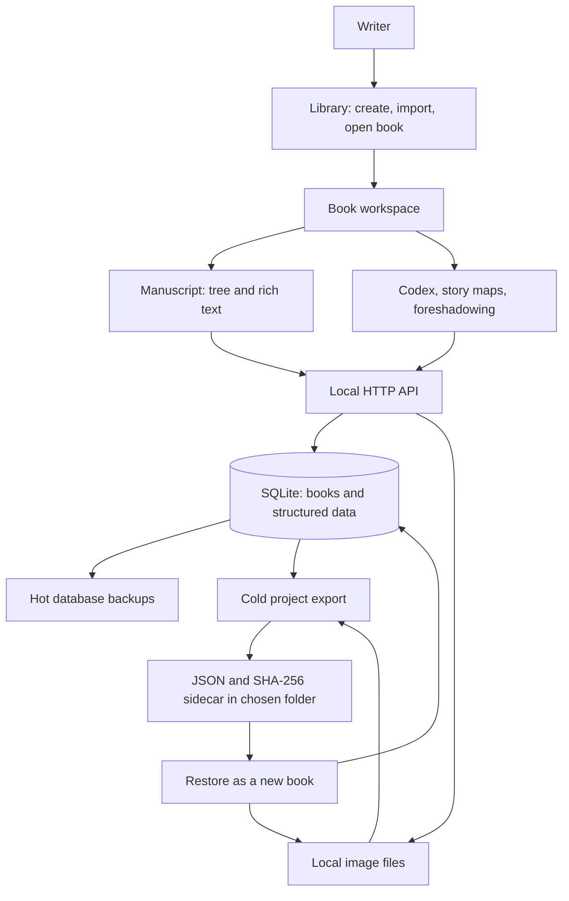
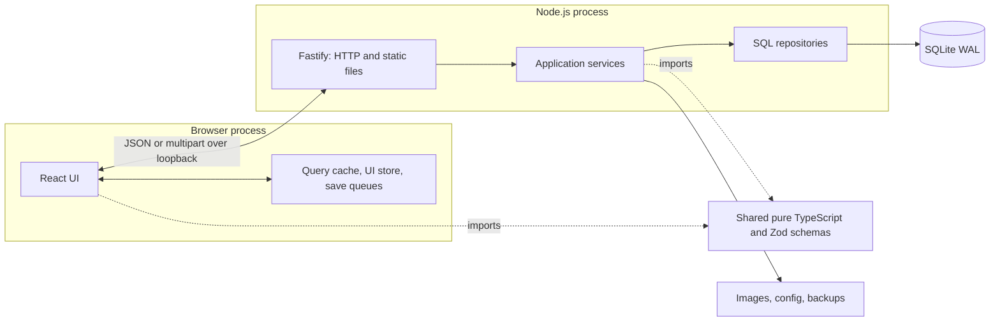
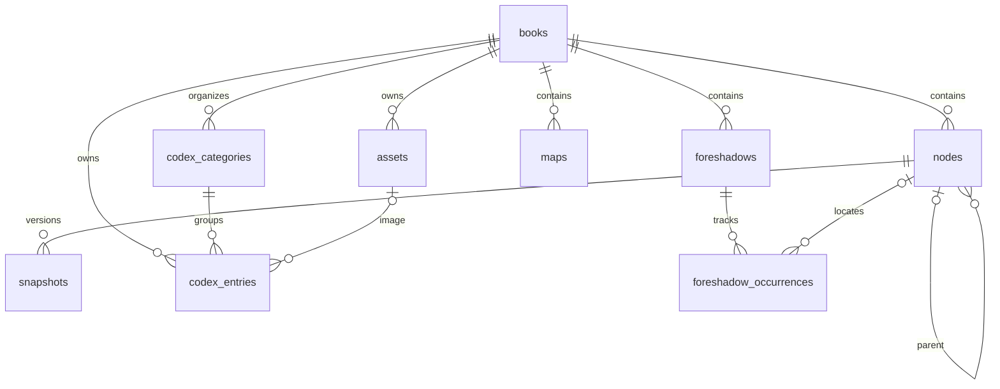
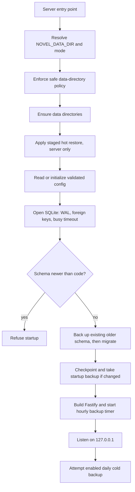
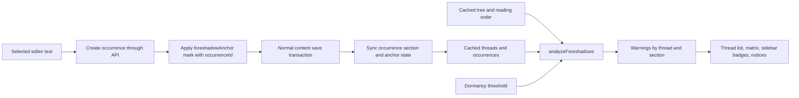
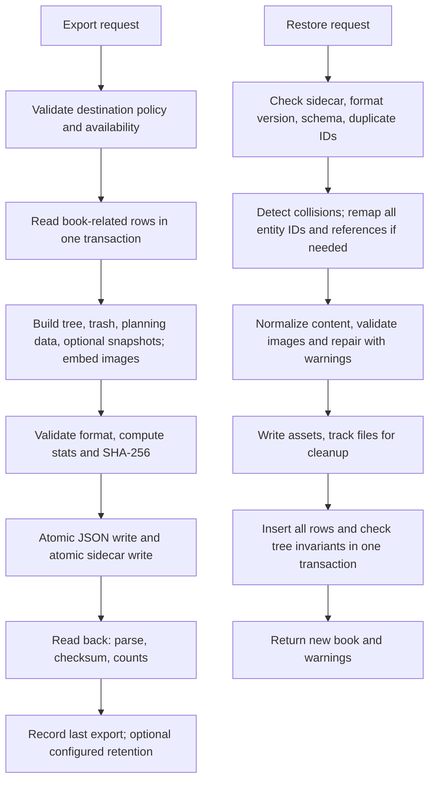

# NovelStudio — Developer Architecture Guide

This guide explains the implemented system, from a first-pass overview to individual save and recovery flows. It is based on the source code and the documents in `docs/`, reviewed on **2026-10-27**. M0–M8 and M7b are implemented; the owner has also confirmed M9 complete, and its fixes and regression tests are present in the code. The unchecked M9 checklist in [ROADMAP.md](./ROADMAP.md) is historical status, not a description of missing runtime components. This guide does not change those acceptance checkboxes.

[ARCHITECTURE.md](./ARCHITECTURE.md) records technical decisions, [PRD.md](./PRD.md) defines requirements, and [COLD_BACKUP_FORMAT.md](./COLD_BACKUP_FORMAT.md) specifies the portable project format. This document is the implementation walkthrough. Links into `src/` identify the code responsible for each behavior. The diagrams use Mermaid; their accompanying text also explains the flows without a diagram renderer.

Read the phases in order for onboarding, or jump to a particular flow:

1. [High-level workflow](#phase-1--high-level-workflow)
2. [Major components and state ownership](#phase-2--major-components-and-state-ownership)
3. [File structure and code navigation](#phase-3--file-structure-and-code-navigation)
4. [Data model and persistence](#phase-4--data-model-and-persistence)
5. [Detailed runtime workflows](#phase-5--detailed-runtime-workflows)
6. [Verification and extension points](#phase-6--verification-and-extension-points)

## Phase 1 — High-level workflow

NovelStudio is a local web application in one npm package. A browser renders the writing workspace; a Node.js process owns the database and filesystem. HTTP traffic stays on loopback. There is no account service, remote backend, synchronization service, or background job system outside that process.



The main user loop is **open a book → select a section → edit → autosave → reorganize or plan → export/backup**. Reorganizing changes reading order, while references continue pointing at stable IDs. Chapter numbers, map link labels, and foreshadow warnings update from the new order.

### Runtime topology



| Environment | Browser entry | API | Data location |
|---|---|---|---|
| Development | Vite on `127.0.0.1:5173` | Fastify on `127.0.0.1:4318`, reached through Vite's `/api` and `/assets` proxy | `./.data-dev/` |
| Production | Fastify serves `dist/client` on `127.0.0.1:4317` | Same origin and process | Resolved by `config.ts`; explicit `NOVEL_DATA_DIR` overrides the production default |
| E2E | Vite on `127.0.0.1:5174` | Fastify on `127.0.0.1:4419` | Fresh temporary directory created by Playwright configuration |

Vite emits bundled code under `/static/`; `/assets/:bookId/:assetId` is reserved for uploaded book images. Installation through the PWA manifest creates a browser app window. There is **no service worker**, and the local server must still run. `NovelStudio.command` checks that an existing server reports production mode before opening it.

## Phase 2 — Major components and state ownership

### Components

| Component | Responsibility | Implementation entry point |
|---|---|---|
| Application shell | Query provider, router, library/settings/workspace pages | [main.tsx](../src/client/main.tsx), [App.tsx](../src/client/App.tsx) |
| Workspace coordinator | Current book/view/item, shared tree data, display titles, panels, focus mode, save-derived cache updates | [WorkspacePage.tsx](../src/client/pages/workspace/WorkspacePage.tsx) |
| Manuscript sidebar | react-arborist tree, drag/keyboard moves, rename, trash, structure settings | [Sidebar.tsx](../src/client/features/manuscript/Sidebar.tsx), [useTreeActions.ts](../src/client/features/manuscript/useTreeActions.ts) |
| Editor | Tiptap/ProseMirror document, formatting, paste cleaning, find, snapshots, anchors | [EditorPanel.tsx](../src/client/features/editor/EditorPanel.tsx) |
| Save coordination | Debounce, serialize requests, retain pending edits, expose failure state | [autosave.ts](../src/client/features/editor/autosave.ts), [map-saver.ts](../src/client/features/maps/map-saver.ts) |
| Planning views | Codex cards/fields, React Flow maps, thread lists/matrix and warnings | [CodexView.tsx](../src/client/features/codex/CodexView.tsx), [MapsView.tsx](../src/client/features/maps/MapsView.tsx), [ForeshadowView.tsx](../src/client/features/foreshadow/ForeshadowView.tsx) |
| Browser API layer | Fetch, typed error handling, response validation, Query hooks and mutations | [api/http.ts](../src/client/api/http.ts), resource modules in `client/api/` |
| HTTP composition | Security hooks, service construction, route registration, errors, static client | [server/app.ts](../src/server/app.ts) |
| Services | Business rules, transaction boundaries, backup and filesystem orchestration | [server/services/](../src/server/services/) |
| Repositories | SQL, row mapping, stored JSON parsing, targeted persistence | [server/repos/](../src/server/repos/) |
| Shared domain code | Tree rules, numbering, text conversion/counting, import splitting, analysis, schemas | [shared/](../src/shared/) |

The normal request path is **view → API wrapper → route validation → service → repository → SQLite**. Services import the same pure domain rules used by the client. Client checks provide immediate feedback; server checks remain authoritative. Database infrastructure in `server/db/` owns connection pragmas, inspection, and migration SQL; feature SQL belongs in repositories.

### Where state lives

| State | Owner and lifetime | Persistence behavior |
|---|---|---|
| Book metadata, settings, manuscript, planning data | SQLite | Authoritative saved project data |
| Uploaded image bytes | Data-directory filesystem | SQLite stores metadata and references; cold export embeds bytes |
| Cold backup settings and last-export records | `config.json` | Atomic file writes, separate from the database |
| Fetched books, tree, Codex, threads, maps | TanStack Query | Browser memory; generally refreshed/invalidateable server state |
| Unsaved section documents | `SectionSaver` instances in the page-wide `SaverRegistry` | Browser memory retained across section/view navigation; not durable across a browser crash |
| Unsaved map data | `MapSaver` plus the map Query cache | Browser memory; map query uses `staleTime: Infinity` to avoid automatic stale-server replacement |
| Notices, one-level move undo, focus mode, last map, content reload epoch | Zustand workspace store | Browser memory |
| Fold state, last section per book, sidebar width, anchor highlighting toggle | `localStorage` | Browser preferences; excluded from project backups |
| Selected book/view/item | URL | Restorable by navigation/reload; missing manuscript item can redirect to the remembered live section |

The default Query configuration disables refetch-on-window-focus and uses a five-second stale time. Maps deliberately override this because their cache includes unsaved local edits. Save queues are separate from both Query and Zustand: a component unmount must not discard text that has not reached the server.

Actual client routes are `/`, `/trash`, `/settings`, `/book/:bookId/manuscript/:nodeId?`, `/book/:bookId/maps/:mapId?`, `/book/:bookId/codex/:entryId?`, and `/book/:bookId/foreshadow`. Book display/structure settings are dialogs; `App.tsx` does not define a separate book-settings route.

## Phase 3 — File structure and code navigation

This is a map of the current source tree, with generated output and runtime data omitted.

```text
NovelStudio/
├── docs/                         requirements, decisions, roadmap, backup format, this guide
├── package.json                  single package, exact dependency versions, npm scripts
├── vite.config.ts                client build and development API proxy
├── playwright.config.ts          isolated browser-test ports and temporary data
├── vitest.config.ts              unit/API test configuration
├── tsconfig*.json                separate client, server, and tooling checks
├── NovelStudio.command           macOS launcher
├── index.html
├── public/                       manifest.webmanifest and application icons
├── scripts/copy-migrations.mjs    copies SQL migrations into the server build
├── src/
│   ├── client/
│   │   ├── main.tsx              React, QueryClientProvider, BrowserRouter
│   │   ├── App.tsx               route definitions
│   │   ├── api/                  one API/hooks module per resource
│   │   ├── stores/workspace.ts   transient UI state and selected preferences
│   │   ├── components/           shared primitives and health indicator
│   │   ├── pages/                library/, workspace/, settings/
│   │   ├── features/
│   │   │   ├── manuscript/       tree UI, move actions, undo, trash, fold/last-node state
│   │   │   ├── editor/           editor, extensions, paste, autosave, snapshots
│   │   │   ├── codex/            categories, templates, entries, character detection UI
│   │   │   ├── maps/             canvas, inspector, graph nodes, map saver
│   │   │   ├── foreshadow/       threads, occurrences, matrix, anchor creation
│   │   │   ├── search/           book-wide find/replace dialog
│   │   │   └── settings/         imports, exports, save guard, hot backup UI
│   │   └── styles/tokens.css     shared CSS variables; components use CSS Modules
│   ├── server/
│   │   ├── index.ts              process lifecycle and listen
│   │   ├── bootstrap.ts          safe data-store initialization
│   │   ├── app.ts                testable Fastify composition
│   │   ├── config.ts             path policy and atomic config/file writes
│   │   ├── security.ts           Host/Origin checks and response headers
│   │   ├── errors.ts             API error and validation helpers
│   │   ├── db/                   connection, schema versioning, backup inspection
│   │   │   └── migrations/       001_init, 002_codex, 003_maps, 004_foreshadows
│   │   ├── routes/               HTTP adapters grouped by resource
│   │   ├── services/             domain operations and filesystem orchestration
│   │   ├── repos/                SQL grouped by entity family
│   │   ├── scripts/              seed, cold export, cold restore, cold verification
│   │   └── test-support.ts       temporary data and test-app helpers
│   └── shared/
│       ├── schemas/              Zod request/response, content and storage schemas
│       ├── tree.ts               tree construction, moves, trash/restore, invariants
│       ├── numbering.ts          display titles and numbering formats
│       ├── content-normalize.ts  flatten nested blockquotes without losing text/marks
│       ├── prosemirror-text.ts   plain text and literal find/replace
│       ├── wordcount.ts          CJK-aware word count
│       ├── foreshadow*.ts        reading-order warnings and anchor ID helpers
│       ├── codex.ts              defaults, field repair, name/alias matching
│       ├── map-*.ts              templates, layout, link resolution/remapping
│       ├── import-split.ts       text decoding and chapter detection
│       ├── manuscript-export.ts Markdown/TXT rendering
│       └── cold-backup.ts        format constants, naming, statistics, reminder helpers
└── tests/
    ├── e2e/                      Playwright feature and review-regression suites
    └── fixtures/                 fabricated input, including Google Docs paste HTML
```

Most Vitest tests are colocated as `*.test.ts`. API tests live at the server root and use Fastify injection. Browser tests live in `tests/e2e/`. There is no monorepo package boundary, generated API client, ORM, separate worker service, or client `routes.tsx`; `App.tsx` is the routing entry point.

For a typical feature, follow one vertical slice: `client/features/maps/` → `client/api/maps.ts` → `server/routes/maps.ts` → `server/services/maps.ts` → `server/repos/maps.ts`, with `shared/schemas/map.ts` defining the data contract.

## Phase 4 — Data model and persistence

### Entity relationships

The current database schema version is **4**, defined by four immutable numbered migrations. IDs are UUID strings; timestamps are ISO strings; structured document/settings fields are JSON stored in SQLite `TEXT` columns.



These edges describe the relational entities. Additional references live in JSON: map links target section/Codex IDs; rich-text anchor marks target occurrence IDs; display settings can target a background asset. The book cover is another asset reference. Those references require service validation and restore remapping; not every reference is a SQL foreign key.

| Entity | Important stored shape | Consequence |
|---|---|---|
| `books` | Metadata, `settings`, cover reference, timestamps, `deleted_at` | Settings contain independent structure/display/foreshadow objects |
| `nodes` | Book/parent IDs, kind, position, title, numbered flag, status, synopsis, content, derived text/count, `rev`, trash marker | One table represents volume, part, chapter, and scene; all can hold prose |
| `snapshots` | Previous content/count, reason, timestamp, section ID | Version history is separate from live text |
| `assets` | Book ID, original display filename, MIME, bytes, SHA-256 | Bytes live at `assets/<bookId>/<assetId>.<ext>` |
| Codex tables | Ordered categories/templates; ordered entry fields and optional image | An entry copies its template at creation; later template changes do not rewrite it |
| `maps` | Metadata plus a complete `MapData` JSON document | Graph nodes/edges are embedded, not separate SQL rows |
| Foreshadow tables | Thread metadata plus section-linked occurrences and anchor state | Reading-order warnings are computed rather than stored |

### Identity, ordering, and derived data

`nodes.parent_id` and dense sibling `position` values define structure. The kind rank is volume < part < chapter < scene; a child must have strictly greater rank, and levels may be skipped. All live sibling positions must be `0..n-1`, parents must belong to the same live book tree, and cycles are forbidden.

Trashing a subtree marks its **root** with `deleted_at`. Descendants are hidden because an ancestor is trashed; they need not have their own marker. Independently trashed descendants remain separate trash entries. Restore appends to the original parent when live and valid, otherwise to the book root. There is a section-trash UI but no permanent section-deletion operation.

Chapter numbers and display titles are computed by [numbering.ts](../src/shared/numbering.ts) in depth-first reading order, with per-kind restart scopes. A move never changes IDs or text. `plain_text` and `word_count` are derived on content writes; foreshadow warnings, current map link labels, and detected characters are derived on reads/rendering. Map `storyTime` is free text and does not control manuscript ordering.

### Transaction and filesystem boundaries

SQLite uses WAL, foreign keys, and a five-second busy timeout. Services wrap related row writes in a synchronous `better-sqlite3` transaction. There is no asynchronous work inside a transaction callback. Section content writes check `rev` and use a revision-conditional SQL update; map saves replace the entire map JSON without a revision check.

SQLite transactions do not include the filesystem. Asset writes and cold restore therefore use atomic file writes and explicit cleanup when subsequent work fails. Cold backup JSON and its sidecar are each written atomically, then read back and verified; they are not one filesystem transaction spanning both files.

## Phase 5 — Detailed runtime workflows

### 5.1 Start the application

Entry points: [index.ts](../src/server/index.ts), [bootstrap.ts](../src/server/bootstrap.ts), [config.ts](../src/server/config.ts), [migrate.ts](../src/server/db/migrate.ts).



The safety guard runs before directory creation or database access. Non-production mode refuses the real production data directory and its descendants, including path aliases checked by the path policy. Migration discovery enforces consecutive filenames; each migration and its `user_version` update commit together. An existing schema is backed up before upgrade; an empty version-zero database has no prior schema to preserve.

`buildApp()` is dependency-injected with the database, paths, and optional test substitutes, allowing API tests without opening a listening socket. `index.ts` owns signals, listen, timers, and shutdown. SIGINT/SIGTERM closes Fastify, stops the hot-backup timer, and closes the database.

### 5.2 Open a book and a section

The route renders `WorkspacePage`, which fetches book/tree data and computes display titles. The tree endpoint returns all sections, including trash, but excludes rich-text content. The editor loads the selected section separately through `GET /api/nodes/:id`.

If a manuscript route has no section ID, the workspace checks the per-book remembered section and redirects only when it is still live. Before loading a section with an existing saver, the editor waits for its flush; if text remains unsaved, it displays that local content instead of replacing it with older server text. Switching sections resets editor history, while the page-wide saver registry survives component changes.

### 5.3 Type and autosave

Entry points: [EditorPanel.tsx](../src/client/features/editor/EditorPanel.tsx), [autosave.ts](../src/client/features/editor/autosave.ts), [routes/content.ts](../src/server/routes/content.ts), [services/content.ts](../src/server/services/content.ts).

```mermaid
sequenceDiagram
    participant E as Editor
    participant S as SectionSaver
    participant R as Content route
    participant C as ContentService
    participant D as SQLite
    E->>E: Normalize document
    E->>S: update(content)
    Note over S: Wait 1000 ms, or explicit flush
    S->>R: PUT content with base rev
    R->>R: Normalize, then validate with Zod
    R->>C: save(id, validated body)
    C->>D: Begin transaction; load current row
    alt Revision differs
        C-->>S: 409 STALE_REVISION
        S-->>E: Keep text; show conflict; stop saving
    else Revision matches and content changed
        C->>D: Snapshot previous content if due
        C->>D: Write content, plain text, count, increment rev
        C->>D: Synchronize anchors and touch book
        C->>D: Commit
        C-->>S: New rev and wordCount
        S-->>E: Saved, or continue with newer queued text
    end
```

Each section has at most one save request in flight. Edits made while it is saving replace the pending payload with the newest document. Identical content is a no-op **after** the revision check. A successful save updates the tree's cached count and refreshes related derived information through workspace listeners.

The saver distinguishes five states:

| State | Meaning | Next action |
|---|---|---|
| `saved` | No pending text | Wait for an edit |
| `dirty` | Debounced edit waiting | Save after one second or flush |
| `saving` | Request in flight | Queue any newer content |
| `error` | Save failed; local text retained | Retry transient failures after five seconds; rejected input shows a persistent copy-text banner |
| `stale` | Server revision has changed | Keep local text and require explicit reload/recovery; no automatic overwrite |

Nested blockquotes are flattened before validation. Paste cleaning preserves only supported formatting, including permitted highlight colors and UUID anchor attributes. The server repeats normalization and validation rather than trusting the editor.

### 5.4 Navigate, trash, replace, restore, or export with pending edits

`flush()` means “finish attempting to save,” **not** “the save succeeded.” Callers must check saver state and retained content afterward. [unsaved-work.ts](../src/client/features/editor/unsaved-work.ts) centralizes that predicate.

| Trigger | Coordination and failure behavior |
|---|---|
| Section/view change | Flush the leaving editor; retain its saver and pending content |
| Hidden tab / page hide | Flush; page hide requests keepalive for small payloads (transport cutoff: 60,000 bytes) |
| Browser unload | `beforeunload` asks for confirmation if section or map savers report unfinished work |
| Trash section | Flush the section and its subtree; refuse trash if anything is still unsaved |
| Snapshot restore | Flush; unresolved work produces Copy unsaved text / Restore anyway / Cancel |
| Find & replace | Flush all section savers; refuse while saving has failed or conflicted |
| Markdown/TXT export | Flush section savers; unresolved work requires Export anyway / Cancel |
| Cold backup export | Same export guard, also flushing map savers |
| Duplicate map | Flush the active map; refuse duplication if that fails |

These guards operate on savers in the current browser page. An export cannot flush unsubmitted edits in another tab. Keepalive and unload prompts reduce accidental loss but do not make browser-memory edits crash-durable.

Snapshots keep previous content, not the newly submitted text. `SnapshotService` takes a non-empty previous version on the first qualifying edit since server start, then when the interval reaches ten minutes, retaining the newest 50. Restore snapshots the current saved version first. Book-wide replacement snapshots every changed section and updates content, counts, revisions, and anchors in one transaction. The client then drops affected savers and bumps `contentEpoch` to reload the editor. Literal book-wide matches stay inside individual text nodes, so they do not cross formatting boundaries.

### 5.5 Move a section and recompute dependent views

Entry points: [tree.ts](../src/shared/tree.ts), [api/nodes.ts](../src/client/api/nodes.ts), [services/manuscript.ts](../src/server/services/manuscript.ts).

```mermaid
sequenceDiagram
    participant T as Sidebar
    participant Q as Query tree cache
    participant A as Manuscript API/service
    participant D as SQLite
    T->>T: Convert drop index; validate target
    T->>Q: Optimistic applyMove
    Q-->>T: New order, display titles, warning badges
    T->>A: POST move with parentId and final index
    A->>D: Begin transaction and load current tree
    A->>A: Run shared applyMove rules again
    A->>D: Write affected structure rows; touch book; commit
    A-->>Q: Authoritative tree
    Note over Q: Reconcile when concurrent writes settle;
    Note over Q: roll back/refetch on failure
```

The API index is the final destination index **after removing the moved node**. `arboristIndexToFinalIndex` handles the downward-drag adjustment. Keyboard actions compute the same target shape. The server renumbers affected sibling positions in one transaction; descendants follow their parent's ID and are not rewritten merely because the subtree moved.

The Query mutations avoid applying an older move response over a newer optimistic tree. Single-level undo sends an ordinary reverse move. Its bookkeeping compares entry identity before restoring an earlier undo entry on failure, so an older failed request cannot erase a newer move's undo.

### 5.6 Edit maps, Codex, and foreshadowing

**Maps.** `MapCanvas` uses React Flow for interaction and shared dagre layout helpers for auto-layout. Persistable changes update the Query cache and queue the full `MapData` document. Dragging saves at drag end; selection alone does not save. `MapSaver` debounces for 800 ms and serializes requests. The service validates the graph and saves JSON plus the book timestamp transactionally. Maps have **last-writer-wins** semantics across tabs; they have no section-style `rev` protection.

Stored map JSON is read through `repairMapData`. Unreadable elements or unknown keys mark a stored map damaged; the readable portion can be displayed, but `MapService.saveData` refuses overwrite with `MAP_DAMAGED`. Incoming React Flow request objects use a separate schema path that strips transient UI keys. Duplication copies the original stored JSON. Map links resolve current section/Codex labels by ID; missing and trashed links remain visible but cannot navigate.

**Codex.** Blank-book creation and text-import commit insert eight default categories in the same transaction as the book. Cold restore preserves exactly the categories present in the file. Deleting all categories leaves an empty state until the user requests defaults. Category templates initialize new entry fields; existing entries own their own ordered field lists. “Characters in this section” is computed by matching names/aliases against text, rather than stored as a section-entry join table.

**Foreshadowing.** Thread/occurrence CRUD is persisted through the API, but warnings run in the browser using [foreshadow.ts](../src/shared/foreshadow.ts). The input is the cached tree plus threads, so optimistic moves immediately affect warning badges, matrix positions, and occurrence order.



Content saves extract anchor IDs and synchronize occurrences within the same transaction as the prose. A cut/pasted anchor follows the section saved with that mark; a removed anchor leaves the occurrence with `anchor_state = missing`. Only occurrences from the same book are updated. Copying the same anchor into two sections makes the last saved section its owner. Section duplication strips anchor marks from the copy, preserving the original occurrence's ownership.

### 5.7 Import text and export a manuscript

The text-import route accepts `.txt`, `.md`, or `.markdown` up to 25 MB. [import-split.ts](../src/shared/import-split.ts) decodes UTF-8 or the supported GB18030 fallback, detects headings, and builds an import plan. Chinese heading detection rejects sentence-like endings, avoiding splits on ordinary prose such as `第二部手机响了。`.

Preview returns section kinds, hierarchy, titles, excerpts, and warnings without writing. Commit receives the file again and recomputes the plan; there is no server-side preview session. One transaction creates the book, default Codex categories, and sections, then checks tree invariants. Cancellation after preview leaves no book behind.

Manuscript export loads live sections in reading order, computes display titles, and renders Markdown or plain text through [manuscript-export.ts](../src/shared/manuscript-export.ts). It is an HTTP attachment download and omits trashed subtrees. Full project export instead uses the cold-backup pipeline below.

### 5.8 Cold backup export and restore

Entry points: [cold-backup.ts](../src/server/services/cold-backup.ts), [cold-backup-restore.ts](../src/server/services/cold-backup-restore.ts), [cold-backup-location.ts](../src/server/services/cold-backup-location.ts). API and CLI reuse these services.



Export includes manuscript, trash, Codex, maps, foreshadow threads/occurrences, images, and optionally snapshots. SQL rows are captured together; image bytes are then read from disk. The JSON carries both rich content and plain text, making it useful without the app. Destination policy prevents exporting inside the source/data directories. An unavailable location fails explicitly; there is no fallback destination.

Each file uses temp-write, flush, rename, and directory flush through `writeFileAtomic`. The exporter avoids existing filenames, verifies the final output, and cleans up newly written files on failure. Old cold backups are retained unless the user explicitly configured retention. Failure to record an otherwise successful export in `config.json` returns a warning.

Restore always inserts a new book. If any imported entity ID collides with its target table, all imported entity IDs are regenerated. Remapping covers parents, cover/background/entry images, Codex categories, map section/entry links, occurrence section/thread IDs, snapshot section IDs, and anchor marks in both section and snapshot content. Map-local graph node/edge IDs stay local to the map. Positions come from array order; display titles and counts are recomputed.

Invalid rich content can fall back to plain text with a warning. Invalid images and unsupported planning fields are handled defensively and reported. Existing books are not overwritten. File cleanup compensates for a failed database insertion; SQLite alone cannot roll back image writes.

The optional daily cold backup runs **after server startup**, not on a continuous daily timer. It skips a day already recorded as successful, exports changed live books through the normal exporter, and records the outcome. A failed attempt can retry on a later startup that day.

### 5.9 Hot backups and staged database restore

[HotBackupService](../src/server/services/hot-backup.ts) creates consistent SQLite copies with `VACUUM INTO`, retaining the newest 20. Startup checks for changes after a WAL checkpoint; an hourly timer checks a dirty flag. In the current server, `app.ts` marks the flag after successful non-GET/non-HEAD HTTP responses via its `onResponse` hook. This is conservative request-level tracking, not a repository callback on every SQL write.

```mermaid
sequenceDiagram
    participant UI as Settings
    participant S as Running server
    participant F as Data-directory files
    participant N as Next server startup
    UI->>S: Request named hot backup restore
    S->>S: Validate database integrity and schema version
    S->>F: Stage pending-restore.db
    S->>F: Back up current database; write pending marker
    S-->>UI: Restart required
    Note over S: Current database remains open and usable
    N->>F: Revalidate staged file before opening SQLite
    N->>F: Preserve old DB, WAL, SHM under backups/replaced-...
    N->>F: Swap staged database into place; remove marker
    N->>N: Continue normal migration and startup
```

Only `index.ts` opts into `openDataStore({ applyPendingRestore: true })`. CLI cold restore and seeding refuse while a restore is pending; cold export may still back up the current database and reports that distinction. Invalid staged data leaves the current database intact and records a failure notice. Hot backups contain the database only: image files remain separate and are not restored by swapping the database.

### 5.10 Request trust boundaries

`security.ts` validates Host against the server's loopback host/port and checks Origin on state-changing methods; absent Origin is allowed for CLI/tests. The server listens only on `127.0.0.1`. Responses set CSP, `nosniff`, and no-referrer headers. The development server's Origin is allowed only through non-production configuration.

JSON bodies have a 25 MB limit; image uploads allow 20 MB, text imports 25 MB, and cold imports 1 GB. Images are sniffed by bytes and restricted to PNG/JPEG/WebP/GIF. Generated ID-based paths determine storage filenames; imported display names are sanitized. Zod validates incoming data and parsed storage structures, while repair paths preserve readable material and report damage. These controls protect a local application; they do not provide multi-user authentication or make it suitable for public network deployment.

## Phase 6 — Verification and extension points

### Current implementation coverage

| Capability | Implementation evidence | Representative tests |
|---|---|---|
| Library, tree and numbering (M0–M3) | Bootstrap, library/manuscript services, shared tree and numbering, sidebar | `library.test.ts`, `nodes.test.ts`, `tree.property.test.ts`, `sidebar.spec.ts` |
| Editor and recoverability (M4) | Savers, content/snapshot services, cold export/restore | `autosave.test.ts`, `content.test.ts`, `cold-backup.test.ts`, `editor.spec.ts` |
| Codex, maps, foreshadowing and anchors (M5–M7b) | All three feature directories, migrations 002–004, anchor synchronization | `codex.test.ts`, `maps.test.ts`, `foreshadow-anchors.test.ts`, matching E2E suites |
| Import/export and polish (M8) | Import splitter, manuscript exporter, search/replace, hot restore, daily cold export, launcher/PWA | `import-text.test.ts`, `search-replace.test.ts`, `hot-backup-restore.test.ts`, `import-export.spec.ts` |
| Review safeguards (M9) | Trash dialog, normalization, save guards, pending-restore isolation, persistent selection, map damage protection | `review-fixes.spec.ts`, `unsaved-work.test.ts`, `move-undo.test.ts`, `bootstrap.test.ts`, `scripts/cli.test.ts`, `schemas/map.test.ts` |

This table records source/test coverage, not a substitute for executing tests or a new manual acceptance record. Deferred features remain deferred: DOCX/EPUB, multi-select moves, swimlane timelines, richer Codex field types, cloud collaboration, and a desktop shell are not part of this implementation. Maps still lack revision conflict detection; there is no server single-instance lock.

### Checks and safe development

From the repository root, with an explicit development data override:

```sh
NOVEL_DATA_DIR=./.data-dev npm run typecheck
NOVEL_DATA_DIR=./.data-dev npm run lint
NOVEL_DATA_DIR=./.data-dev npm test
NOVEL_DATA_DIR=./.data-dev npm run test:e2e
```

Vitest API tests create isolated temporary stores; Playwright creates its own temporary server store and refuses to reuse an existing server. The tree property test applies 1,000 randomized moves and checks invariants. Cold-backup tests cover round trips and ID/reference remapping. E2E tests exercise user-visible races such as typing then immediately switching, trashing, or exporting. Real novel data and existing cold-backup folders must not be used for development verification.

### Where to make a change

| Change | Start here | Preserve or extend |
|---|---|---|
| Tree semantics or numbering | `shared/tree.ts`, `shared/numbering.ts` | Pure tests, invariant/property tests, server validation, optimistic UI and move-index adapter |
| Formatting or paste | `shared/schemas/content.ts`, editor extensions/paste/normalization | Server save validation, snapshot/replace behavior, cold restore, text export, regression tests |
| New persisted field/entity | Shared schema, numbered migration if needed, repository/service | Cold export, cold restore, ID remapping, format schema and round-trip tests in the same change (`COLD-09`) |
| Action that discards or reads editor state | Saver registry, `unsaved-work.ts`, export/snapshot guards | Flush and inspect outcome; do not treat a resolved flush as success |
| Map data changes | `shared/schemas/map.ts`, map service and canvas | Damaged-data read protection, allowed request keys, full-document saving and cold restore |
| New API operation | Resource route, service, repository and client API module | Zod validation, same-book ownership, trash rules, transaction boundary and API tests |
| Runtime or backup behavior | Bootstrap, config, hot/cold backup services | Startup guard, pre-migration backups, staged restore ownership, atomic writes and recovery tests |

Keep shared logic free of DOM, Node APIs, and I/O. New dependencies require approval and an update to the technology table in `ARCHITECTURE.md`. Feature and bug-fix work should continue to reference PRD requirement IDs and update the relevant design documentation alongside the code.
