# Your novel, from first line to final chapter

## The NovelStudio user guide

NovelStudio gives your novel a place to grow. Write your chapters, rearrange their order, keep character notes close by, and follow the clues you plant along the way. You can start with a single chapter and add the planning tools whenever you need them.

Your books stay on your computer. You do not need an account or an internet connection to write.

This guide uses a made-up novel, **The Lantern Road**. The screenshots show the actual app with sample content. The small “dev data” label at the bottom identifies the demonstration library; your own library may look different.

### Find what you need

- [Open NovelStudio](#open-novelstudio)
- [Write your first chapter](#write-your-first-chapter)
- [Find your way around](#find-your-way-around)
- [Organize and rearrange chapters](#organize-and-rearrange-chapters)
- [Make writing comfortable](#make-writing-comfortable)
- [Find words and make revisions](#find-words-and-make-revisions)
- [Keep character and world notes](#keep-character-and-world-notes)
- [Plan with story maps](#plan-with-story-maps)
- [Track clues and payoffs](#track-clues-and-payoffs)
- [Bring in an existing manuscript](#bring-in-an-existing-manuscript)
- [Export your manuscript](#export-your-manuscript)
- [Keep a separate backup](#keep-a-separate-backup)
- [Recover your work](#recover-your-work)
- [When something goes wrong](#when-something-goes-wrong)
- [Handy Mac shortcuts](#handy-mac-shortcuts)

## Open NovelStudio

These instructions start with NovelStudio already set up on your Mac.

1. In Finder, open the NovelStudio folder and double-click **NovelStudio.command**.
2. A Terminal window opens. Leave it open while you use NovelStudio: it keeps the app running.
3. Wait for your browser to open the **Library**. Starting for the first time, or after an update, may take a little longer.
4. Make the browser window wide enough to see the chapter list, writing area, and details panel side by side. If the writing area looks squeezed, enlarge the window.

If the launcher reports that setup is incomplete, ask whoever installed NovelStudio to finish setup before you begin writing.

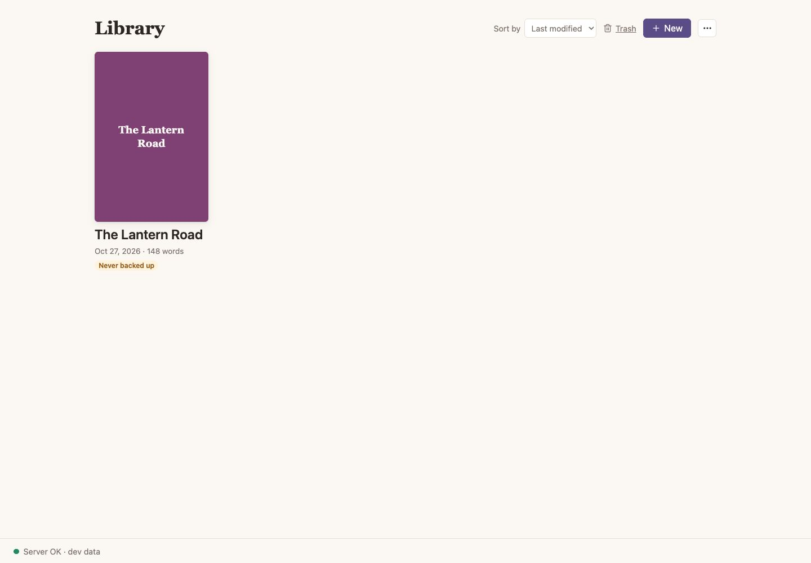

*The Library is your starting point. Click a book’s cover or title to open it.*

To finish a writing session, wait for **Saved**, then close the writing window. To stop NovelStudio completely, go to its Terminal window and press **Control+C**. Next time, double-click **NovelStudio.command** again.

If you already use NovelStudio in its own app window, the same rule applies: keep the launcher’s Terminal window running while you write.

## Write your first chapter

### 1. Create your book

1. In the Library, click **New**.
2. Choose **Create blank…**.
3. Enter a title, such as *The Lantern Road*.
4. Click **Create**, then click the new book’s card to open it.

You can change the title later. You do not need to choose a cover or plan the whole novel first.

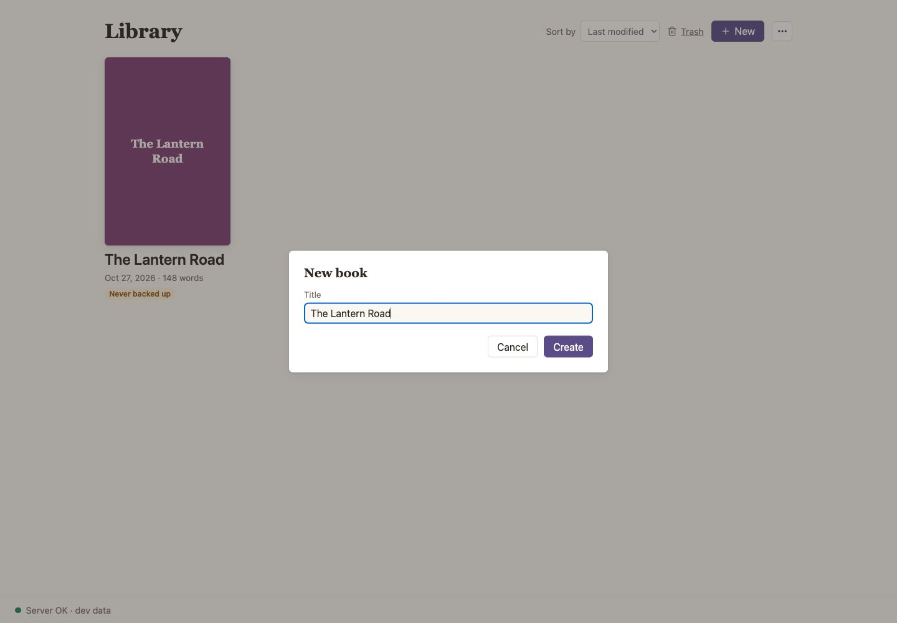

### 2. Add a chapter

1. Click the **+** beside **MANUSCRIPT** on the left.
2. Choose **New chapter**.
3. In the panel on the right, enter a **Title**. Click outside the field to finish editing it.

Type only the chapter’s name—for example, **The Last Ferry**. NovelStudio supplies “Chapter 1” for you.

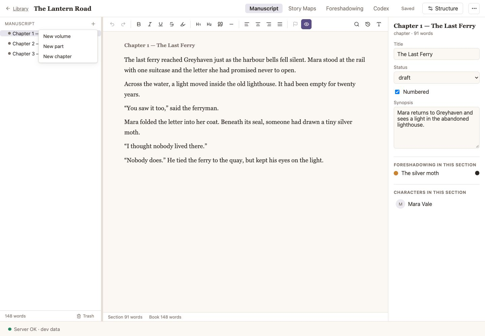

### 3. Start writing

Click the large writing area beneath the chapter heading and type your opening paragraph. Pause briefly and look for **Saved** at the top of the window. Your text saves automatically after you stop typing for about a second.

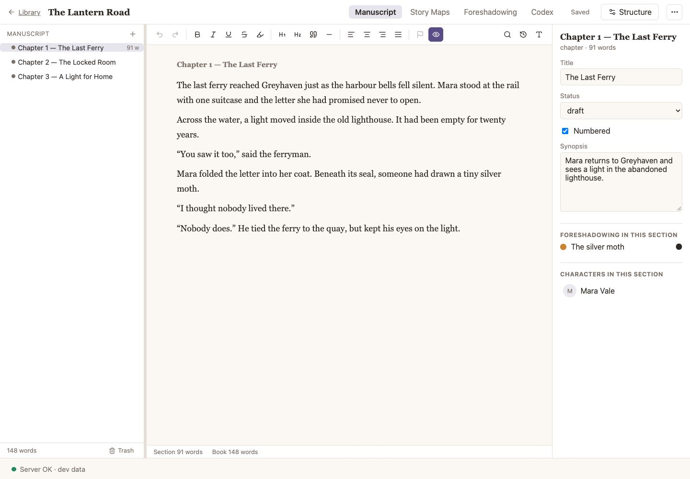

*Write in the middle. Use the right panel for a short reminder of what happens in this chapter.*

To continue, use **+ → New chapter** again. Click any chapter in the left-hand list to return to it.

Before your first long writing session, [set up a separate backup](#keep-a-separate-backup).

## Find your way around

The links along the top open four different views of the same book:

| View | Use it to… |
|---|---|
| **Manuscript** | Write, revise, and arrange your chapters. |
| **Story Maps** | Lay out events and connections as a diagram. |
| **Foreshadowing** | Keep track of clues, hints, and their payoffs. |
| **Codex** | Keep notes about characters, places, and your story’s world. |

Click **Library** at the upper left to return to your books. Opening a book again normally takes you back to the last section you opened in that browser.

The **three-dot menu** at the upper right of a book is the **Book menu**. It contains focus mode, find and replace, exports, and Settings. The Library has its own three-dot menu for Settings and exporting all books.

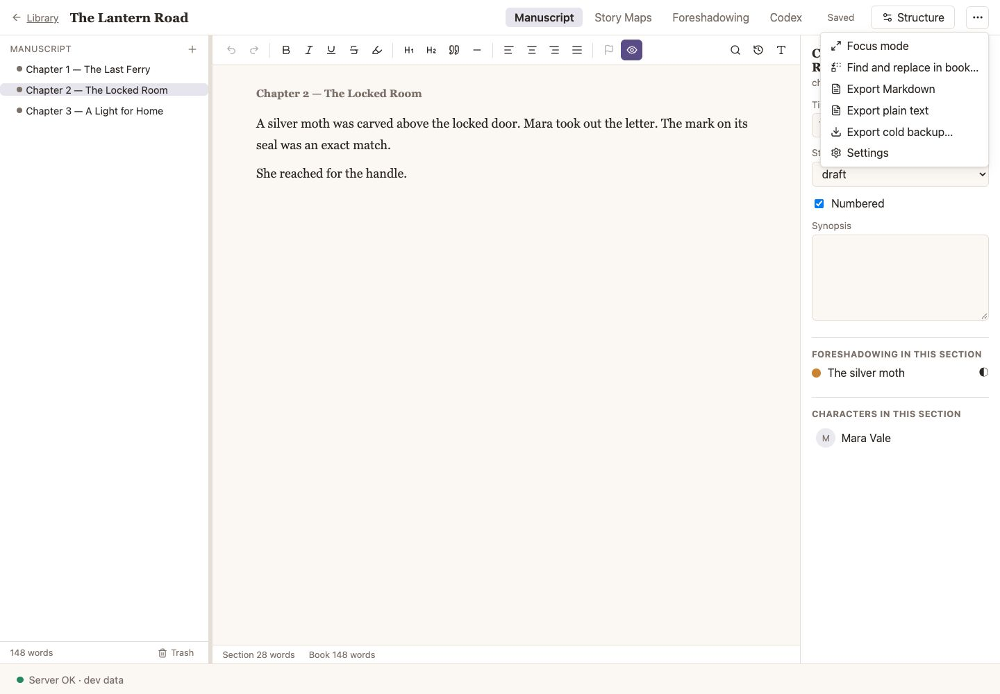

To change a book’s title, author, description, or cover, return to the Library and open the three-dot menu on its card. Choose **Edit metadata**, make your changes, and click **Save**. Cover pictures can be PNG, JPEG, WebP, or GIF files.

## Organize and rearrange chapters

### Choose how much structure you need

A **section** is any item in the manuscript list. Start with chapters; add larger groups or smaller scenes only when they help.

| Section | A useful example |
|---|---|
| Volume | A major division of a long work. |
| Part | “The Journey” or “The Return,” containing several chapters. |
| Chapter | A chapter your reader will encounter in sequence. |
| Scene | A smaller piece of a chapter that you want to move separately. |

The order from largest to smallest is **Volume → Part → Chapter → Scene**. You can skip levels: chapters do not need to belong to a part or volume. Any section can contain writing of its own.

### Add, rename, or copy a section

Right-click a section in the left-hand list. On a trackpad, use a two-finger click.

- **New chapter after** adds another chapter beside the selected one.
- **New scene inside** adds a scene within a chapter. Other section types offer the corresponding choices.
- **Rename** changes the title. You can also double-click the title or edit **Title** in the right panel.
- **Duplicate** makes a separate copy, including the sections inside it.
- **Move to trash** removes the section and its contents from the manuscript list. You can restore it later.

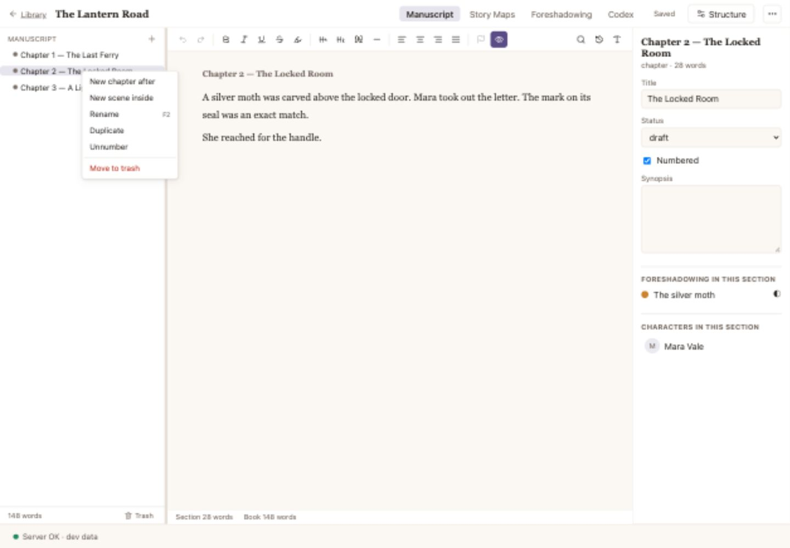

Use the small arrow beside a group to hide or reveal its contents. Drag the divider beside the manuscript list to make that list wider or narrower.

### Move a chapter

1. Press and hold on the chapter in the left-hand list.
2. Drag it to the new position.
3. Watch the drop indicator before releasing: it shows where the chapter will go.
4. Release, then check its position and new number.

You can move a chapter between parts. Moving a part also moves the chapters and scenes inside it. NovelStudio refuses arrangements that do not make sense, such as putting a part inside a chapter.

For a small adjustment, click the section in the list and press **Option+↑** or **Option+↓**. Keep the chapter list selected for these shortcuts; they are not typing shortcuts. **Command+Z** in the list undoes the most recent structural move.

Moving a chapter changes the reading order. Its writing and planning links stay attached to it. After a large rearrangement, check **Foreshadowing** for clues that now appear in the wrong order.

### Make a prologue or change numbering

For a prologue, select the chapter, give it the title **Prologue**, and clear **Numbered** in the right panel. It keeps its place in the manuscript without using up a chapter number. You can also choose **Unnumber** from its right-click menu.

Click **Structure** at the top of the book to change numbering for the whole book. The easiest starting points are **English** and **Chinese (中文)**. Check the previews, then click **Save**.

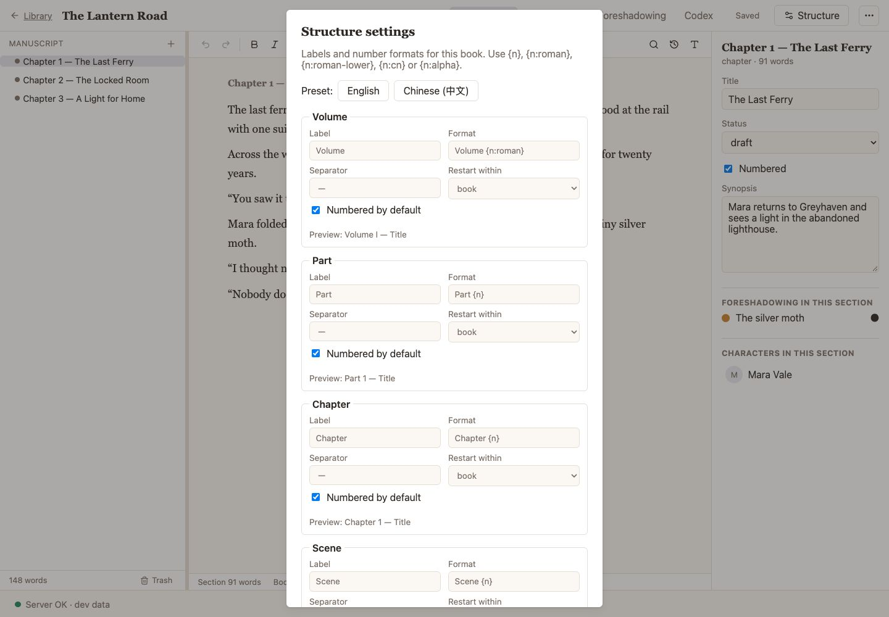

**Restart within** controls when numbering starts again. For chapters, **book** keeps counting throughout the novel; **part** starts again in each part. Leave the other fields as they are unless you want a custom style.

### Keep track of progress

Select a section and use the right panel:

- **Status:** choose **idea**, **draft**, **revising**, or **done**.
- **Synopsis:** write a short reminder of what happens here.

Click outside a field when you finish editing. These notes help you navigate; the synopsis is separate from the prose your reader will see.

## Make writing comfortable

### Format your text

Select a word or passage, then choose a button in the toolbar above the writing area. Hover over a button to see its name.

You can apply bold, italic, underline, strikethrough, a colored highlight, a heading, or a quote. Alignment buttons position paragraphs to the left, center, right, or both margins. **Scene break** inserts a divider in the text; it does not create a movable scene in the chapter list.

Use **Command+Z** to undo typing and **Command+Shift+Z** to redo it. This typing history starts fresh when you switch sections. For older text, use [Snapshots](#bring-back-an-earlier-version-of-a-chapter).

Pasting from another writing app keeps supported formatting and removes fonts and styling that NovelStudio does not use. Use **Command+Shift+V** to paste plain text.

The bottom of the editor shows word counts for the section and book. Select a passage to see its selection count. Chinese, Japanese, and Korean writing is counted by characters alongside word counts for other text.

### Change the look of your writing space

1. Click **Display settings** in the editor toolbar.
2. Choose a font, text size, line spacing, and editor width.
3. Choose **Light**, **Dark**, or **Sepia**. You can also set paragraph spacing, a background color, or a background picture.
4. Click **Save**.

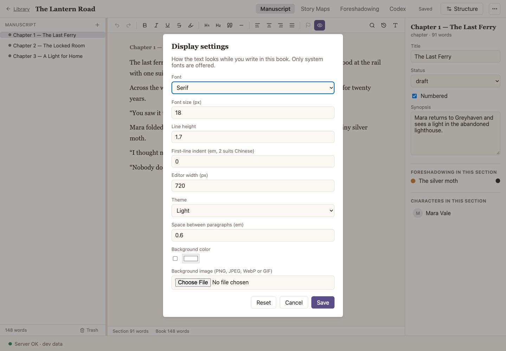

These settings apply to this book’s writing space. They are not page-layout instructions for an exported manuscript.

### Hide distractions

Choose **Book menu → Focus mode**, or press **Command+Shift+F**. The chapter list and side panels disappear so you can concentrate on writing. The save status remains visible.

Click **Exit focus mode** to bring the panels back. You can also use **Command+Shift+F** again.

## Find words and make revisions

### Find something in the current chapter

Click in the writing area and press **Command+F**, or click **Find in section** in the toolbar. Enter a word or phrase and use the search controls to move between matches.

### Replace a name across the book

1. Open **Book menu → Find and replace in book…**.
2. Enter the old name in **Find** and the new name in **Replace with**.
3. Choose **Match case** if capital letters should matter.
4. Click **Find all**.
5. Read the results and clear the checkbox beside any chapter you want to leave unchanged.
6. Click the **Replace…** button, which tells you how many matches and sections it will change.

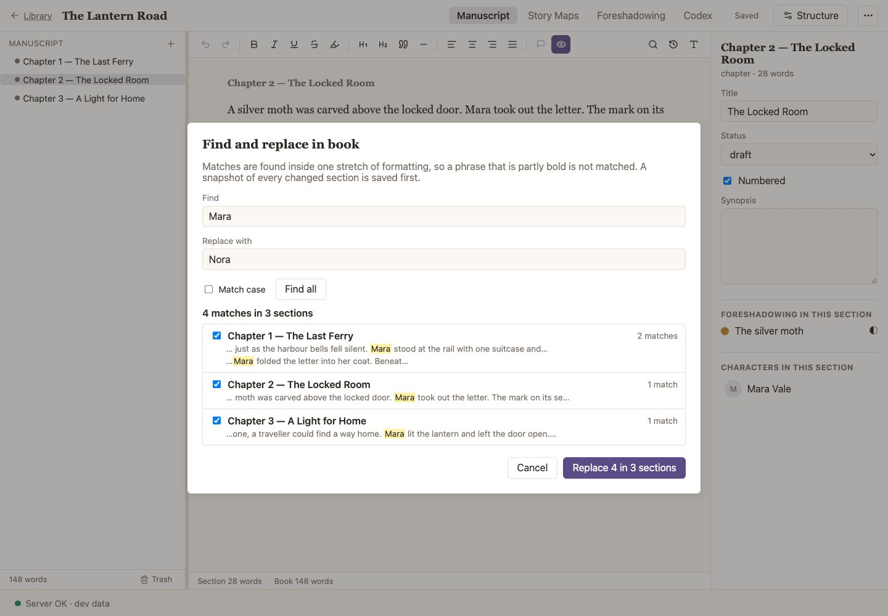

*Review the matching passages before replacing them. Cancel leaves the manuscript unchanged.*

An earlier version of every affected section is saved in **Snapshots** before replacement. This search covers manuscript text; update character cards and planning notes separately if needed.

A phrase split across different formatting—for example, a name with only half of it bold—may not appear in book-wide search. Try a shorter search if an expected result is missing.

## Keep character and world notes

**Codex** is your story notebook. Use **Characters** for people, **Locations** for places, and the other categories for your setting’s history, organizations, creatures, and rules.

### Create a character

1. Click **Codex** at the top of your book.
2. Select **Characters** on the left.
3. Click **New entry**, type the character’s name, and click **Create**.
4. Add a short **Summary** and fill in whichever fields are useful. You can leave the rest blank.
5. Click outside the field and wait for the entry’s **Saved** message.

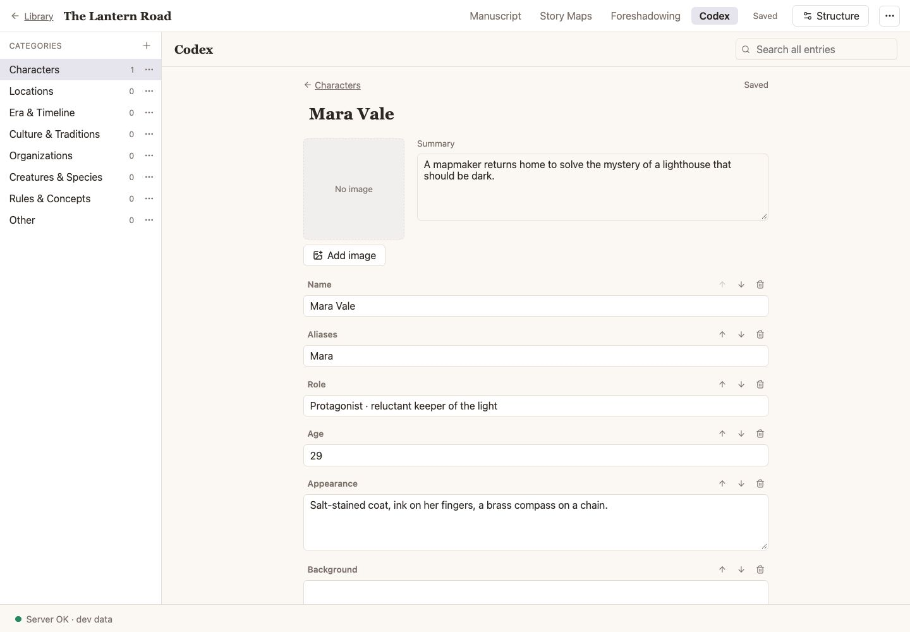

Use **Add image** for a portrait or reference picture. At the bottom of the entry, enter a **New field name**, choose short or long text, and click **Add field** to add your own prompt—perhaps “Secret” or “What she fears.” Field names can be edited, and arrow buttons move fields up or down.

Use **Search codex** to find entries across categories. The menu beside a category lets you manage it and its template. Changing a category’s template affects new entries; it does not rewrite existing character cards. A category must be empty before you can delete it.

In Manuscript, **Characters in this section** shows characters whose names appear in the prose. Add nicknames to the character’s **Aliases** field, separated by commas, so the app can recognize those too.

Deleting a Codex entry is permanent within the app; it does not go to manuscript Trash. Make a [cold backup](#keep-a-separate-backup) before a major cleanup.

## Plan with story maps

A story map lets you arrange events and connect ideas without changing the chapter order.

### Start a map

1. Click **Story Maps**, then **New** in the maps list.
2. Give the map a title.
3. Choose a starting layout and click **Create**.

| Template | Good for… |
|---|---|
| **Blank** | Arranging your own ideas from scratch. |
| **Timeline** | Following events from one stage to the next. |
| **Plot tree** | Breaking a premise into plot stages and branches. |
| **Character arc** | Following how a character changes. |

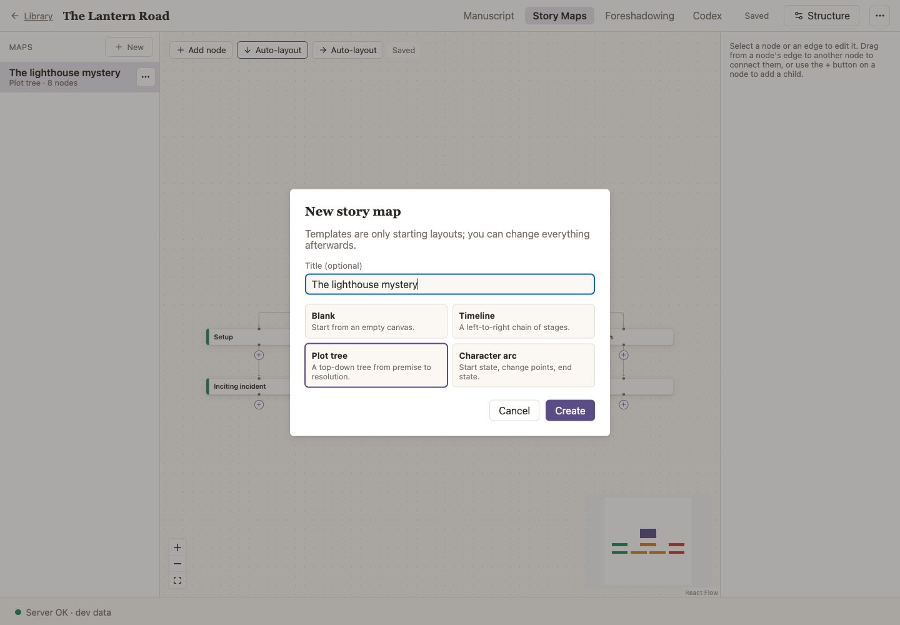

The template is only a starting point. You can change its titles and layout.

### Add detail and connect ideas

Click a box on the map—the app calls it a **node**—to edit its **Title**, **Description**, **Story time**, and color on the right. Story time can be a phrase such as “The night Mara returns.”

- Drag boxes to arrange them.
- Click **Add node** for another box, or the **+** on a box for a connected child.
- Drag from a connection point on one box to another box to connect them.
- Click a connecting line to give it a label.
- Drag the background to move around; use the zoom buttons and **Fit View** to find your way back.
- Use either **Auto-layout** button to arrange the map top to bottom or left to right.

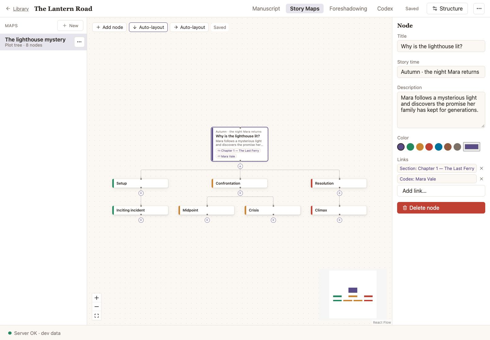

### Link a plot point to a chapter or character

1. Select a box and click **Add link…** in its details.
2. Choose a chapter or Codex entry. You can add more than one.
3. Click **Done**.
4. Click a link on the map to open the connected writing or notes.

Chapter links keep working when you rename or rearrange chapters. Map changes save automatically; check the **Saved** message on the map before leaving. Use only one window to edit a particular map at a time.

The three-dot menu beside a map’s name offers **Rename…**, **Duplicate**, and **Delete…**. Deleting a whole map is permanent within the app. It does not delete the chapters or character cards linked from it.

## Track clues and payoffs

In **Foreshadowing**, a **thread** is one idea you want the reader to remember. An **occurrence** records where that idea appears.

For example, *The Lantern Road* introduces a silver moth on a letter, repeats it on a locked door, and finally explains what it means.

| Role | What it means | Our example |
|---|---|---|
| **● Setup** | Introduce the clue or promise. | A moth on a letter’s seal. |
| **◐ Hint** | Remind the reader or develop the clue. | The same moth above a door. |
| **★ Payoff** | Reveal its meaning or deliver the promised result. | The moth marks a place of welcome. |

### Record a thread

1. Click **Foreshadowing → New thread**.
2. Give it a title, such as **The silver moth**. Add a description if helpful.
3. Choose a status: **Planned**, **Planted**, **Paid off**, or **Abandoned**.
4. Click **Create thread**.
5. Click **+ Occurrence** on the thread.
6. Choose a **Section** and **Role**. Optionally add a quoted excerpt and a note.
7. Click **Add occurrence**. Repeat for hints and the payoff.

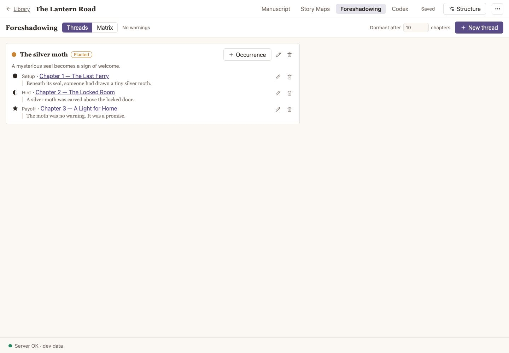

Update the thread’s status yourself as your plan develops. Adding a payoff does not automatically change **Planted** to **Paid off**.

### See the whole pattern

Click **Matrix** for a chapter-by-chapter overview. Each row is a thread, and the symbols show where its setup, hints, and payoffs occur. Click a symbol to open its section.

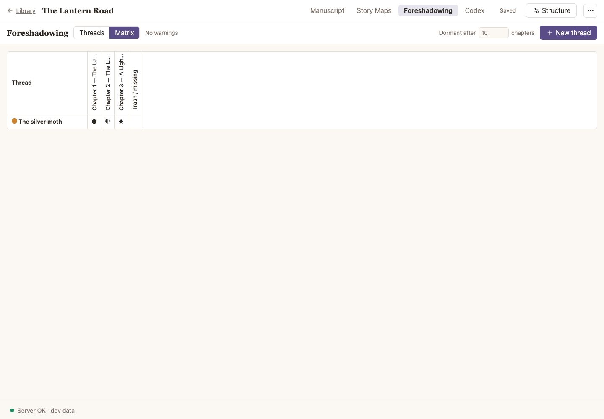

Warnings help you spot a payoff before its setup, a payoff without a setup, a long gap between appearances, or an appearance in a trashed section. A setup without a payoff also gets a reminder. Use **Dormant after** to choose how many chapters may pass before a gap needs attention.

These are prompts to review your story. They do not judge whether an intentional mystery or unusual reading order is right for your novel.

### Attach a clue to the actual words

You can also start from the manuscript:

1. Select the clue’s words in the editor.
2. Click the flag-shaped **Mark as foreshadowing** button.
3. Choose **Mark as setup**, **Mark as hint**, or **Mark as payoff**.
4. Pick an existing thread or create a new one, then confirm with **Mark text**.

This attaches the occurrence to the selected words. Cutting and pasting them into another section within NovelStudio moves the occurrence with them. Use cut rather than copy when you intend to move it. If you delete the words, the thread keeps the occurrence and marks its anchor as missing so you can review it.

The eye button in the editor shows or hides these highlights. Hiding them does not remove the clues.

## Bring in an existing manuscript

1. Go to **Library → New → Import text or Markdown…**.
2. Choose a `.txt` or `.md` file.
3. Review the detected chapters and their excerpts.
4. Adjust **Book title** and **Chapter numbering style** if needed.
5. If the chapter breaks look wrong, turn off **Detect chapters from headings** to bring everything into one section instead.
6. Click **Import … sections**, then **Open book**.

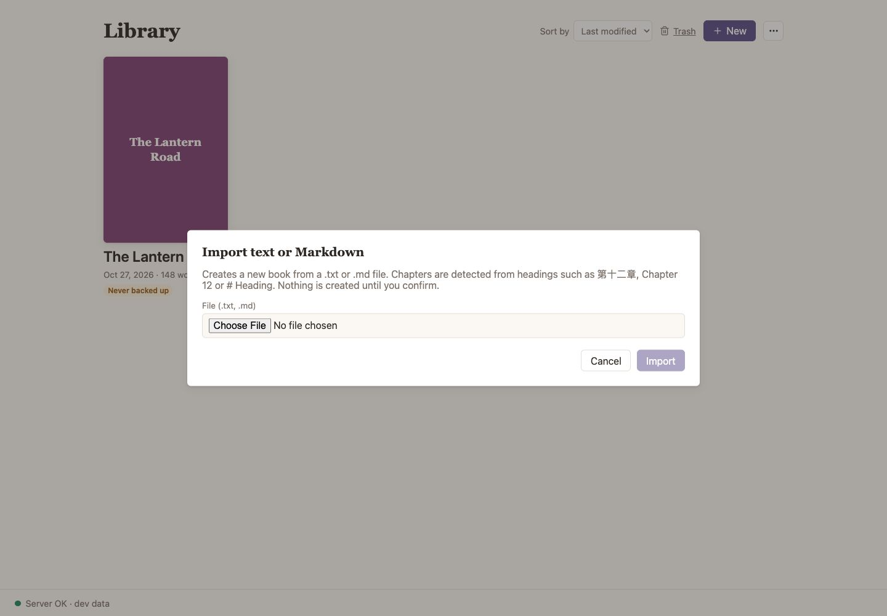

*After you choose a file, the dialog shows a preview before you confirm the import.*

Headings such as “Chapter 1,” “第一章,” and Markdown headings help the app find chapter breaks. Import creates a new book and leaves existing books alone. **Cancel** closes the preview without creating a book.

Files must be no larger than 25 MB. Word documents (`.docx`), PDFs, and EPUB files cannot be imported directly. If your manuscript is in Word, save a separate plain-text copy in Word first and keep your original document. A plain-text copy will not retain its formatting.

## Export your manuscript

1. Open your book and wait for **Saved**.
2. Open the **Book menu**.
3. Choose **Export plain text** or **Export Markdown**.
4. Find the downloaded file in your browser’s downloads, usually the Mac’s Downloads folder.

**Plain text** is useful when you need the words without formatting. **Markdown** retains supported formatting as text notation and is useful in apps that read Markdown.

Both exports follow the current reading order and include section headings. Trashed sections are left out. Planning notes, maps, and character cards are not included in a manuscript export. For those, make a **cold backup** as described below.

If an export warns that some text has not saved, choose **Cancel**, preserve the unsaved text, and resolve the save problem first. **Export anyway** may leave your latest changes out of the file.

## Keep a separate backup

Autosave keeps your working copy up to date. A **cold backup** is a separate file containing a whole book, including its manuscript, trashed sections, character notes, maps, clues, and pictures. You can use it to bring the book back later.

### Choose a backup folder

1. Open **Settings** from the Library’s three-dot menu or the Book menu.
2. Under **Cold backup**, click **Choose…** and select a folder. A folder on a separate drive protects against losing this computer; a folder that your own sync service backs up can also be useful.
3. Click **Validate** to check the location, then **Save settings**.
4. Leave **Keep only the newest…** unchecked if you want to keep all backup copies. Turning it on allows older copies to be deleted.
5. Check **Include section snapshots** if you want earlier chapter versions included too. This makes larger files.

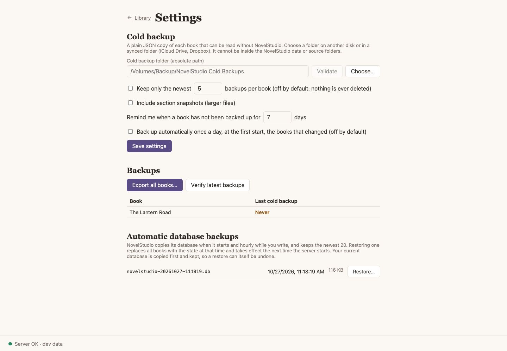

The folder cannot be inside NovelStudio’s own app or data folders. If **Choose…** is unavailable, the folder field accepts its full location; ask for help finding that location if needed.

### Back up a book

1. Open the book’s **Book menu → Export cold backup…**. The book card’s menu in the Library offers this too.
2. Use the saved location, or choose **Another folder, just this once**.
3. Decide whether to include snapshots, then click **Export**.
4. Wait for the result to say **Verified** and show the file location. Read any warnings before closing the dialog.

A cold backup is written to the selected folder; it is not a normal browser download. Keep the `.novelstudio.json` file and its matching `.sha256` file together. The second file helps the app check that the backup has not changed or become damaged.

For every book at once, use **Settings → Export all books…**, or the same command in the Library menu. Check each book’s result: one book can succeed while another fails.

Use **Verify latest backups** in Settings to check the most recent recorded copies again. This checks existing files; it does not create a fresh backup. A Library card saying **Never backed up** or showing an overdue reminder is a prompt to make one.

### Optional daily backup

Settings offers **Back up automatically once a day, at the first start, the books that changed**. Check it and click **Save settings** if you want this help.

It runs when NovelStudio starts, with the backup drive or folder available. It does not continuously back up your writing during the day. Make a manual backup after a substantial writing session or before a major rewrite.

## Recover your work

Choose the smallest recovery that solves the problem:

| What happened? | Start here |
|---|---|
| You just made a typing mistake. | **Command+Z** in the editor. |
| You need older text from one chapter. | That chapter’s **Snapshots**. |
| You moved a section to Trash. | **Trash** at the bottom of the manuscript list. |
| You moved a whole book to Trash. | **Trash** in the Library. |
| You need a book from a separate backup file. | **New → Import cold backup…** in the Library. |
| You need to roll the entire library back. | **Automatic database backups** in Settings; read the warning below first. |

### Bring back an earlier version of a chapter

1. Open the chapter and click **Snapshots** in the editor toolbar.
2. Click a dated entry and read its preview.
3. If it is the version you want, click **Restore this version**.

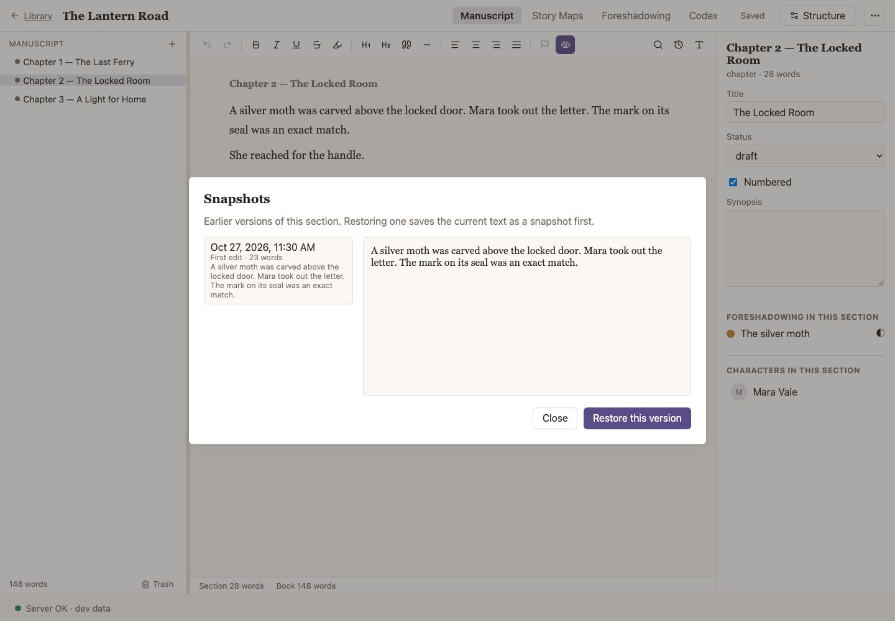

The current saved text is kept as another snapshot before restoration. Snapshots are created automatically at intervals and before certain changes; they are not a record of every keystroke. A new chapter may not have any yet, and only the newest 50 are kept per section.

If the app warns that the current text is unsaved, choose **Copy unsaved text**, paste it into a separate document, and save that document before considering **Restore anyway**. Choose **Cancel** to keep working without restoring.

### Restore a section from Trash

1. In Manuscript, click **Trash** at the bottom of the chapter list.
2. Find the section by title and click **Restore**.
3. Check its position and move it if necessary.

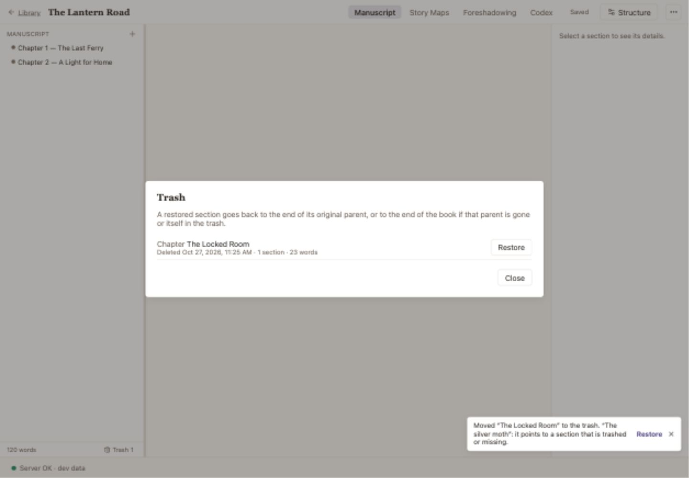

The section returns with its text and the sections removed with it. It goes to the end of its original group, or the end of the book if that group is no longer available. It may therefore receive a different chapter number. Sections that were already trashed separately need their own restore.

### Restore a whole book from Library Trash

Click **Library → Trash**, find the book, and choose **Restore**. This is different from the Trash inside a book, which holds manuscript sections.

Avoid **Delete permanently** unless you mean to remove the book for good. It requires typing the book’s title and cannot be reversed through Trash.

### Restore a book from a cold backup

1. In the Library, choose **New → Import cold backup…**.
2. Select the `.novelstudio.json` backup file.
3. If you have the matching `.sha256` file, select it under **Checksum file** too.
4. Click **Import** and read the result, including any warnings.
5. Click **Open book** and check its chapters, notes, and pictures.

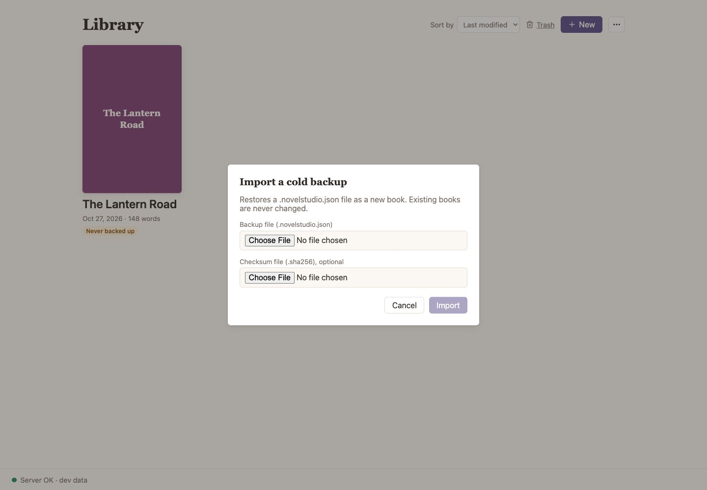

This creates a **new book** and leaves your existing books unchanged. If a book with the same title already exists, the restored copy receives a dated suffix. Keep both until you have checked the restored one.

If the checksum does not match, choose **Cancel** and try another backup copy. **Import anyway** bypasses that warning; it does not repair the file. If any content could not be restored, keep the original backup and review the reported warnings before relying on the recovered book.

### Roll back the whole library

**Settings → Automatic database backups** lists earlier copies of the library. This recovery affects **all books**, not just the book you were viewing. It also does not replace missing image files. Prefer a chapter snapshot or a single-book cold backup when that is enough.

Before proceeding, make cold backups of any current books you need to keep.

1. In **Automatic database backups**, choose **Restore…** beside the required date.
2. Read the confirmation and click **Restore at next start** only if you want the whole library returned to that time.
3. Stop writing. Changes made while a restore is waiting will not appear in the restored library.
4. In NovelStudio’s Terminal window, press **Control+C**, then double-click **NovelStudio.command** again.
5. Reopen the Library and check your books.

Refreshing the browser alone does not complete the restore. Before restarting, you can use **Cancel restore** in Settings to withdraw it. The app keeps a copy of the library it replaces; ask for help if you need to recover from that saved copy.

## When something goes wrong

| What you see | What to do |
|---|---|
| **Saving…** stays on screen, or **Error — click for details** appears. | Keep the window open. Click the error for details. Copy the latest text into a separate document and save it. Check that NovelStudio’s Terminal window is still running. Do not reload until your unsaved work is safe. |
| **Copy section text** appears in an error banner. | Click it, paste into a separate document, and save that document before closing or reloading. If copying fails, select and copy the writing manually. |
| **Changed elsewhere — reload** appears. | Another window has saved a newer version. Copy your current text somewhere safe first. Then reload and compare with the saved version before continuing. Use one writing window per book to avoid competing edits. |
| The browser asks whether you want to leave. | Stay on the page while work is unsaved. Wait for saving to finish, or preserve the text elsewhere before leaving. |
| The page will not load. | Start NovelStudio with its launcher and leave the Terminal window open. If it reports an error, keep the message for the person helping you. |
| A chapter seems missing. | Expand any collapsed groups in the manuscript list, then check that book’s **Trash**. |
| A book seems missing. | Check **Library → Trash**. Make sure you opened your usual NovelStudio installation, not a demonstration library. |
| A backup folder is unavailable. | Reconnect the drive or make the folder available, then use **Validate** and retry the export. Check for a **Verified** result. |
| A story map is read-only or reports unreadable content. | Keep the map and any backups. Ask for help recovering it rather than deleting it. |

## Handy Mac shortcuts

| Action | Shortcut | Where to use it |
|---|---|---|
| Undo typing | **Command+Z** | In the writing area. |
| Redo typing | **Command+Shift+Z** | In the writing area. |
| Find in this section | **Command+F** | In the writing area. |
| Find and replace in the book | **Command+Option+F** | In the book workspace. |
| Enter or leave focus mode | **Command+Shift+F** | In Manuscript. |
| Paste plain text | **Command+Shift+V** | In the writing area. |
| Rename a section | **F2** (or **Fn+F2** on some keyboards) | With a section selected in the chapter list. |
| Move a section up or down | **Option+↑ / Option+↓** | With the chapter list focused. |
| Move inside the previous section | **Tab** | In the chapter list, when that grouping is allowed. |
| Move out one level | **Shift+Tab** | In the chapter list. |
| Undo the most recent structural move | **Command+Z** | With the chapter list focused. |

*Guide prepared against NovelStudio 0.1.0 on October 27, 2026. All story text and names in the screenshots are fictional.*
